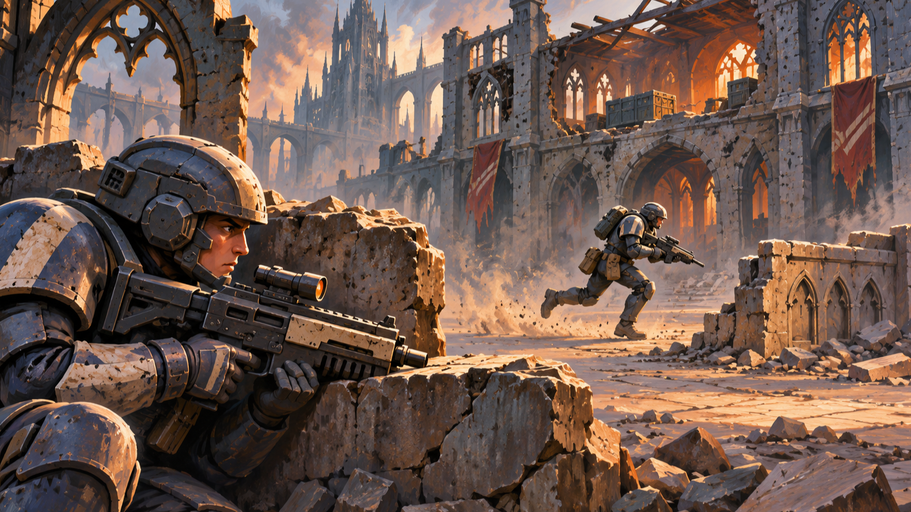
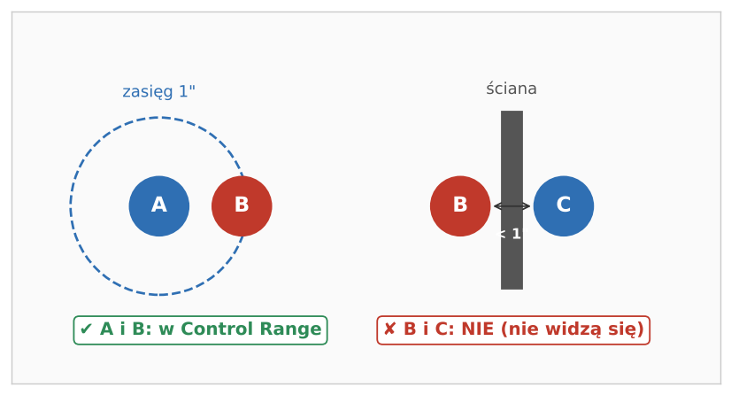
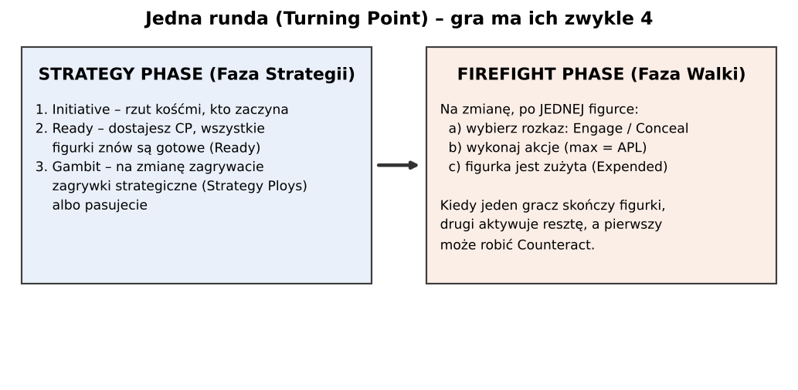
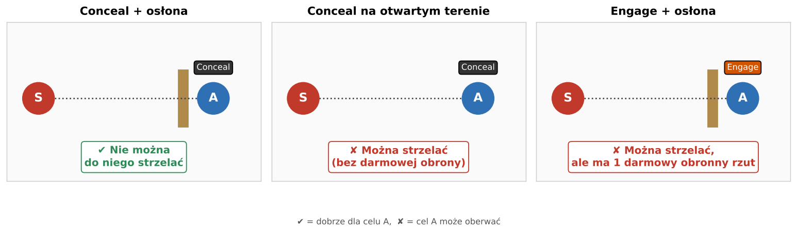
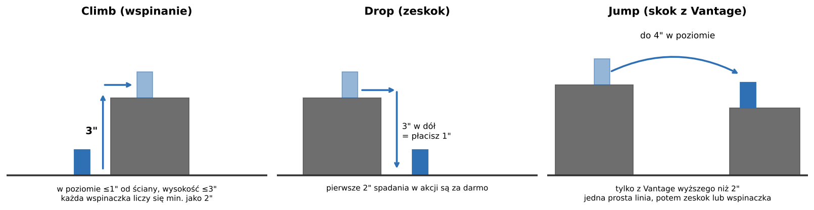
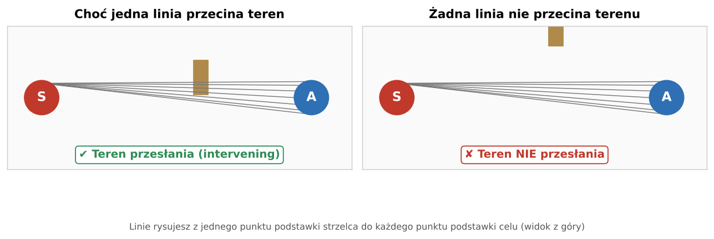
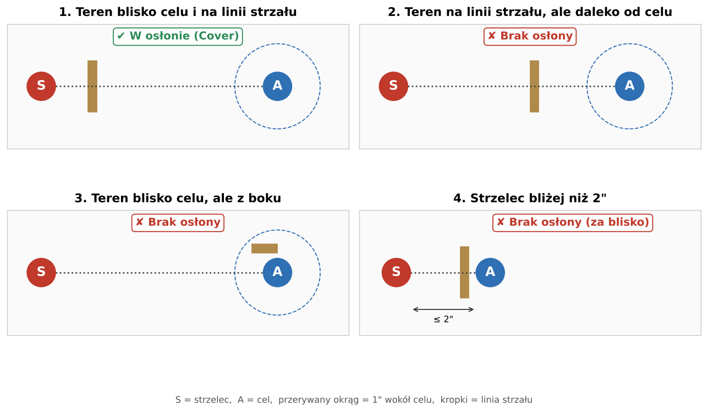
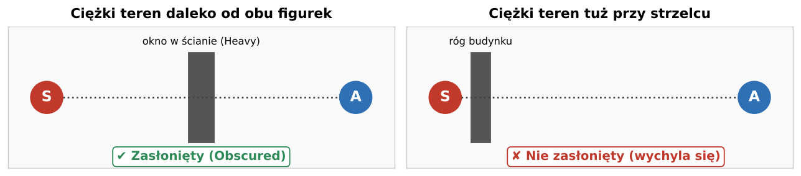
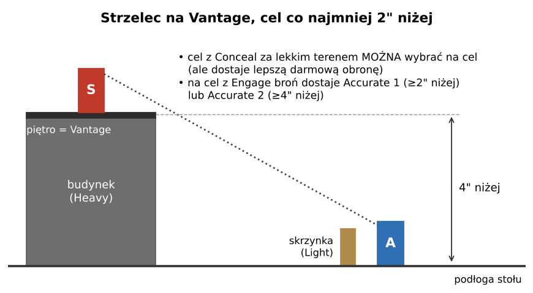

# Część 1 — Zasady podstawowe

**Kill Team (3. edycja): jak się ruszać, strzelać i walczyć**

[← Powrót do spisu podręcznika](README.md) · Następna część: [Misje →](02_misje.md)

Zasady zgodne z Kill Team 3. edycji (Core Book 2024) oraz oficjalnymi poprawkami i wyjaśnieniami opublikowanymi do października 2026.

---

## Spis treści

1. [Jak czytać ten poradnik](#1-jak-czytać-ten-poradnik)
2. [O co chodzi w Kill Team?](#2-o-co-chodzi-w-kill-team)
3. [Czego potrzebujesz](#3-czego-potrzebujesz)
4. [Karta postaci (Datacard)](#4-karta-postaci-datacard)
5. [Kości — jak rzucać i liczyć](#5-kości--jak-rzucać-i-liczyć)
6. [Odległości i Control Range](#6-odległości-i-control-range)
7. [Przebieg rundy](#7-przebieg-rundy)
8. [Rozkazy: Engage i Conceal](#8-rozkazy-engage-i-conceal)
9. [Akcje](#9-akcje)
10. [Ruch i teren](#10-ruch-i-teren)
11. [Widoczność, osłona i zasłonięcie](#11-widoczność-osłona-i-zasłonięcie)
12. [Strzelanie krok po kroku](#12-strzelanie-krok-po-kroku)
13. [Walka wręcz krok po kroku](#13-walka-wręcz-krok-po-kroku)
14. [Obrażenia i stan zdrowia](#14-obrażenia-i-stan-zdrowia)
15. [Cechy broni (Weapon Rules)](#15-cechy-broni-weapon-rules)
16. [Rodzaje terenu](#16-rodzaje-terenu)
17. [Znaczniki i cele misji](#17-znaczniki-i-cele-misji)
18. [Najczęstsze sytuacje w grze](#18-najczęstsze-sytuacje-w-grze)
19. [Najczęstsze błędy początkujących](#19-najczęstsze-błędy-początkujących)
20. [Walka w ciasnych korytarzach (Guard)](#20-walka-w-ciasnych-korytarzach-guard)
21. [Ściągawka](#21-ściągawka)
22. [Gdzie szukać oficjalnych zasad i obrazków](#22-gdzie-szukać-oficjalnych-zasad-i-obrazków)

---

## 1. Jak czytać ten poradnik

W grze wszystkie nazwy są po angielsku. Żeby łatwo było się dogadać z innymi graczami i znaleźć coś w podręczniku, zostawiamy angielską nazwę, a obok w nawiasie dajemy polskie tłumaczenie. Wygląda to tak:

> **Silent** (Cicha): możesz strzelać z tej broni, nawet gdy twój żołnierz się ukrywa.

Najpierw nazwa po angielsku, w nawiasie polski odpowiednik, a po dwukropku wyjaśnienie zasady.

W tekście znajdziesz też takie ramki:

> 💡 **Wskazówka** — podpowiedź, jak grać sprytniej.

> ⚠️ **Uwaga** — miejsce, gdzie gracze często się mylą.

---

## 2. O co chodzi w Kill Team?

Kill Team to gra figurkowa w świecie Warhammera 40 000. Każdy gracz dowodzi małym oddziałem elitarnych żołnierzy — zwykle od 5 do 14 figurek. Twoje figurki to **operatives** (agenci, żołnierze). Wszystkie razem tworzą twój **kill team** (oddział specjalny).

Walczycie na niewielkim stole pełnym budynków, murków i skrzyń. Żeby wygrać, zwykle trzeba **zdobywać i utrzymywać cele misji** — samo pokonanie wroga to nie wszystko. Cele misji opiszemy dokładnie w osobnym poradniku. Tu skupiamy się na tym, jak figurki się ruszają, strzelają i walczą.

Kilka słów, które będą się powtarzać:

- **Friendly operative** (przyjazny żołnierz): twoja figurka.
- **Enemy operative** (wrogi żołnierz): figurka przeciwnika.
- **Active operative** (aktywny żołnierz): figurka, która właśnie wykonuje swój ruch.
- **Killzone** (strefa walki): stół do gry razem z całym terenem. Zwykle ma 30" × 22" (około 76 × 56 cm).
- **Killzone floor** (podłoga strefy): sam blat stołu, najniższy poziom.

---

## 3. Czego potrzebujesz

- **Figurki** dla obu graczy, każda na swojej okrągłej lub owalnej podstawce.
- **Zasady twojego oddziału** — są za darmo na stronie warhammer-community.com i w aplikacji Kill Team.
- **Miarkę w calach**. Jeden cal (1") to 2,54 cm.
- **Co najmniej 10 zwykłych kości sześciennych** (oznaczamy je **D6**).
- **Żetony i znaczniki** — żeby pamiętać, kto ma jaki rozkaz, kto jest ranny itd.
- **Stół z terenem** (killzone).
- **Pakiet misji** (mission pack) — opisuje, co trzeba zrobić, żeby wygrać.

---

## 4. Karta postaci (Datacard)

Każdy rodzaj żołnierza ma swoją **datacard** (kartę postaci). Są na niej wszystkie najważniejsze liczby.

### Statystyki żołnierza

- **APL — Action Point Limit** (Limit Punktów Akcji): ile punktów akcji żołnierz może wydać, gdy się aktywuje. Zwykli żołnierze mają **2**, Space Marines zwykle **3**. APL służy też do liczenia, kto kontroluje cel misji.
- **Move** (Ruch): jak daleko żołnierz może przejść, na przykład 6".
- **Save** (Obrona): jaki wynik musisz wyrzucić na kości obrony, żeby się obronić, na przykład 3+ lub 4+.
- **Wounds** (Rany): ile obrażeń żołnierz może przyjąć. To jakby jego punkty życia.

### Statystyki broni

Na karcie są dwie grupy broni: **dystansowa** (do strzelania) i **do walki wręcz**. Każda broń ma:

- **Atk** — Attacks (Ataki): ile kości ataku rzucasz.
- **Hit** (Trafienie): jaki wynik musisz wyrzucić, żeby trafić, na przykład 3+.
- **Dmg** — Damage (Obrażenia): dwie liczby, na przykład **3/4**. Pierwsza to obrażenia ze zwykłego trafienia, druga z trafienia krytycznego.
- **WR** — Weapon Rules (Cechy broni): specjalne zasady broni, na przykład *Heavy* albo *Lethal 5+*. Opisujemy je w rozdziale 15.

> ⚠️ **Uwaga:** W Hit i Save **mniejsza liczba jest lepsza**. 2+ to świetny strzelec, 5+ to kiepski. Gdy zasada mówi, żeby coś **pogorszyć o 1** (worsen), to 3+ zmienia się w 4+. Gdy mówi, żeby **poprawić o 1** (improve), to 4+ zmienia się w 3+.

### Granice zmian statystyk

- APL nigdy nie może się zmienić o więcej niż **1 w górę lub 1 w dół**. Żołnierz z APL 2 może mieć najwyżej 3 i najmniej 1, nieważne ile zasad by go zmieniało.
- Move nigdy nie może spaść **poniżej 4"**.
- Jeśli statystyki zmieniają się w trakcie akcji, nowa wartość działa dopiero **po zakończeniu tej akcji**.

### Inne części karty

- **Abilities** (Zdolności): specjalne umiejętności żołnierza.
- **Unique actions** (Akcje unikalne): akcje, które może wykonać tylko ten żołnierz.
- **Keywords** (Słowa kluczowe): nazwy pisane WIELKIMI LITERAMI. Inne zasady mogą się do nich odnosić, na przykład „każdy żołnierz z słowem kluczowym LEADER…”.
- **Base size** (Rozmiar podstawki) w milimetrach.

---

## 5. Kości — jak rzucać i liczyć

### Zapis „x+”

**4+** znaczy: wyrzuć 4, 5 albo 6. **3+** znaczy: wyrzuć 3, 4, 5 albo 6.

### D3

Jeśli zasada każe rzucić **D3**, rzucasz zwykłą kością i dzielisz wynik przez 2, zaokrąglając w górę:

| Wynik na D6 | 1 | 2 | 3 | 4 | 5 | 6 |
|---|---|---|---|---|---|---|
| Wynik D3 | 1 | 1 | 2 | 2 | 3 | 3 |

### Trzy rodzaje wyników

Kiedy rzucasz kośćmi ataku lub obrony, każda kość może dać jeden z trzech wyników:

- **Critical success** (Sukces krytyczny, „krytyk”): **6 to zawsze krytyk**.
- **Normal success** (Zwykły sukces): wynik równy lub większy niż wymagany, ale nie 6.
- **Fail** (Porażka, pudło): wynik za niski. **1 to zawsze pudło**, nawet jeśli masz jakieś bonusy.

Kości z sukcesem są **retained** (zatrzymywane). Pudła są **discarded** (odrzucane).

### Przerzuty (Re-roll)

- Jedną kość można przerzucić **tylko raz**. Nie wolno przerzucić już przerzuconej kości.
- Po przerzucie musisz zostawić nowy wynik, nawet jeśli jest gorszy.
- Kości, które zatrzymujesz bez rzucania (na przykład z osłony albo z cechy *Accurate*), nie mają liczby na sobie i nie można ich przerzucać.

### Roll-off (Rzut porównawczy)

Obaj gracze rzucają jedną kością. Kto ma więcej, wygrywa. Przy remisie rzucacie jeszcze raz.

### Command Re-roll (Przerzut dowódcy)

Każdy gracz ma zawsze dostęp do tej zagrywki:

> **Command Re-roll** (Przerzut dowódcy) — koszt 1 CP: po rzucie kośćmi ataku lub obrony możesz przerzucić **jedną** z nich. To jedyna zagrywka, której można użyć więcej niż raz w tej samej rundzie.

---

## 6. Odległości i Control Range

### Jak mierzyć

- Odległość między żołnierzami mierzysz od **najbliższego punktu podstawki** do najbliższego punktu drugiej podstawki. Samą figurkę (karabin, ręce, pelerynę) pomijasz.
- **Within** (w zasięgu): wystarczy, że jakakolwiek część podstawki jest w tej odległości.
- **Wholly within** (całkowicie w zasięgu): cała podstawka musi być w tej odległości.
- Do obszarów stołu (na przykład strefy rozstawienia) mierzysz tylko w poziomie — jakbyś patrzył z góry.

### Control Range (Zasięg kontroli)

To jedno z najważniejszych pojęć w grze.

> **Control Range** (Zasięg kontroli): coś jest w zasięgu kontroli twojego żołnierza, jeśli jest **w odległości do 1"** od niego **i jest dla niego widoczne**.

Muszą być spełnione **oba** warunki. Jeśli wróg stoi 0,5" od ciebie, ale za grubą ścianą, przez którą się nie widzicie, to **nie** jesteście w swoim zasięgu kontroli.

Zasięg kontroli działa w obie strony: jeśli ty jesteś w zasięgu wroga, to on jest w twoim.

Control Range decyduje o bardzo wielu rzeczach:

- czy możesz walczyć wręcz,
- czy możesz strzelać (gdy wróg jest w twoim zasięgu kontroli — **nie możesz**),
- czy możesz się normalnie ruszać,
- czy masz osłonę,
- kto kontroluje cel misji.

Gdy żołnierze są nawzajem w swoim zasięgu kontroli, mówi się potocznie, że są **„w zwarciu”**.

---

## 7. Przebieg rundy

Bitwa trwa zwykle **4 rundy**. Runda po angielsku to **Turning Point** (Punkt zwrotny). Każda runda ma dwie fazy: najpierw **Strategy Phase**, potem **Firefight Phase**.

### Przed bitwą (w skrócie)

- Gracze wybierają oddziały i misję, rozkładają teren i cele misji.
- Każdy gracz dostaje na start **2 CP**.
- Gracze na zmianę wystawiają po jednej trzeciej swojego oddziału w swojej **drop zone** (strefie rozstawienia).
- **Każdy żołnierz zaczyna grę z rozkazem Conceal** (ukryty).

Dokładne przygotowanie bitwy krok po kroku znajdziesz w [części 2 — Misje](02_misje.md).

### Strategy Phase (Faza strategii)

**Krok 1. Initiative** (Inicjatywa)

Gracze robią rzut porównawczy. **Zwycięzca decyduje, kto ma inicjatywę** — może wziąć ją sobie albo oddać przeciwnikowi.

- Przy remisie decyduje gracz, który **nie miał** inicjatywy w poprzedniej rundzie.
- W pierwszej rundzie, przy remisie, decyduje gracz, który nie miał inicjatywy podczas rozstawiania.

> ⚠️ **Uwaga:** W misjach turniejowych **Approved Ops 2025** do rzutu o inicjatywę dochodzą **karty inicjatywy**, którymi można zmienić wynik. Opis jest w [części 2](02_misje.md#4-inicjatywa-i-karty-inicjatywy).

Gracz z inicjatywą:

- aktywuje swojego żołnierza jako pierwszy w fazie walki,
- rozstrzyga, w jakiej kolejności dzieją się zasady, które działają w tym samym momencie.

**Krok 2. Ready** (Gotowość)

- **Command Points** (Punkty dowodzenia, CP): w pierwszej rundzie każdy gracz dostaje **1 CP**. W każdej kolejnej rundzie gracz z inicjatywą dostaje **1 CP**, a gracz bez inicjatywy **2 CP**. CP, których nie wydasz, zostają na później.
- Wszyscy żołnierze stają się **Ready** (gotowi do działania). Odwracasz ich żetony rozkazu jasną stroną do góry.

**Krok 3. Gambit**

Zaczynając od gracza z inicjatywą, gracze na zmianę albo używają jednej **Strategic Gambit** (zagrywki strategicznej), albo pasują. Kończy się, gdy obaj spasują jeden po drugim.

- Najczęstsze zagrywki strategiczne to **Strategy Ploys** (Zagrywki strategiczne) z zasad twojego oddziału. Każda kosztuje zwykle 1 CP.
- Każdej zagrywki strategicznej możesz użyć najwyżej **raz na rundę**.

### Firefight Phase (Faza wymiany ognia)

To najważniejsza część gry. Gracze **na zmianę aktywują po jednym żołnierzu**. Zaczyna gracz z inicjatywą.

Gdy aktywujesz żołnierza:

1. **Determine Order** (Wybierz rozkaz): ustalasz, czy ma rozkaz **Engage**, czy **Conceal**. Możesz zostawić ten sam albo zmienić.
2. **Perform Actions** (Wykonaj akcje): żołnierz wykonuje akcje i wydaje na nie punkty akcji.
3. **Expended** (Zużyty): gdy skończysz, żołnierz jest zużyty. Odwracasz jego żeton ciemną stroną do góry. W tej rundzie już się nie aktywuje.

Potem kolej przeciwnika. I tak na zmianę, aż wszyscy żołnierze obu graczy będą zużyci. Wtedy runda się kończy.

W tej fazie możesz też wydawać CP na **Firefight Ploys** (Zagrywki bojowe) — na przykład na Command Re-roll. Każdej zagrywki (poza Command Re-roll) możesz użyć najwyżej raz na rundę.

### Counteract (Kontra)

Co, jeśli ty masz już wszystkich żołnierzy zużytych, a przeciwnik ma jeszcze kilku gotowych? Przeciwnik aktywuje ich dalej, ale za każdym razem, gdy normalnie byłaby twoja kolej, możesz zrobić **Counteract**:

> **Counteract** (Kontra): wybierz jednego swojego **zużytego** żołnierza z rozkazem **Engage**. Wykonuje on **jedną akcję za 1 AP zupełnie za darmo**.

Zasady kontry:

- Każdy żołnierz może skontrować najwyżej **raz na rundę**.
- Podczas kontry żołnierz może przejść **najwyżej 2"**, nawet jeśli wykonuje Reposition.
- Nie można w kontrze wykonać akcji Guard.
- Żołnierz z rozkazem **Conceal nie może kontrować**.
- Kontra jest dobrowolna. Po niej (albo jeśli zrezygnujesz) kolej wraca do przeciwnika.
- Kontra to nie aktywacja, tylko coś „zamiast aktywacji”.

> 💡 **Wskazówka:** Kontra to dobry powód, żeby niektórzy twoi żołnierze kończyli aktywację z rozkazem Engage. Mogą potem odpowiedzieć ogniem na końcu rundy.

---

## 8. Rozkazy: Engage i Conceal

Każdy żołnierz zawsze ma jeden z dwóch rozkazów. Wybierasz go na początku aktywacji i obowiązuje aż do następnej aktywacji tego żołnierza.

> **Engage** (Do walki): żołnierz działa normalnie. Może strzelać, szarżować i kontrować. Ale **można do niego strzelać zawsze, gdy jest widoczny**.

> **Conceal** (Ukryty): żołnierz **nie może strzelać** (akcja Shoot), **nie może szarżować** (akcja Charge) i **nie może kontrować**. Za to, gdy jest **w osłonie, nie jest prawidłowym celem** — nie można do niego strzelać.

Co żołnierz z rozkazem Conceal **może** robić: chodzić, sprintować, wycofywać się, walczyć wręcz, podnosić i kłaść znaczniki, wykonywać akcje misji.

| Sytuacja celu | Czy można do niego strzelać? |
|---|---|
| Engage, na otwartej przestrzeni | Tak, normalnie |
| Engage, w osłonie | Tak, ale cel dostaje 1 darmową obronę (cover save) |
| Conceal, na otwartej przestrzeni | Tak, normalnie — został „złapany” |
| Conceal, w osłonie | **Nie!** |

> 💡 **Wskazówka:** Wyobraź sobie, że żołnierz z rozkazem Conceal kuca za murkiem i się nie wychyla. Nawet jeśli figurka jest trochę widoczna na stole, w grze uznajemy, że się chowa.

> 💡 **Kiedy który rozkaz?**
> - **Engage** — gdy chcesz strzelać albo szarżować, gdy stoisz za ciężką ścianą, przez którą wróg i tak nie widzi, albo gdy chcesz mieć możliwość kontry.
> - **Conceal** — gdy żołnierz biegnie do celu misji, gdy jest ranny i chcesz go ochronić, albo gdy nie ma w kogo strzelać.

---

## 9. Akcje

### Punkty akcji (AP)

Każda akcja kosztuje **Action Points** (Punkty akcji, AP). Podczas jednej aktywacji żołnierz może wydać najwyżej tyle AP, ile wynosi jego **APL**.

**Ważna zasada:** żołnierz **nie może wykonać tej samej akcji dwa razy** w jednej aktywacji. Ta zasada to **action restrictions** (ograniczenia akcji). Wyjątek: jeśli jakaś zasada z karty postaci wyraźnie na to pozwala.

Nie musisz z góry mówić, co zrobisz. Wykonujesz jedną akcję, patrzysz, co się stało, i dopiero wtedy wybierasz następną.

Jeśli zaczniesz akcję, ale okaże się, że nie da się jej dokończyć (na przykład ruch się nie mieści), cofasz wszystko do stanu sprzed akcji. Akcja się nie liczy i AP nie są wydane.

**Przykład:** żołnierz z APL 2 może zrobić Reposition (1 AP) i Shoot (1 AP), bo to razem 2 AP. Nie może zrobić Fall Back (2 AP) i Shoot (1 AP), bo to razem 3 AP.

### Rodzaje akcji

- **Universal actions** (Akcje uniwersalne): każdy żołnierz może je wykonywać. Opisujemy je niżej.
- **Unique actions** (Akcje unikalne): tylko ci żołnierze, którzy mają je na karcie.
- **Mission actions** (Akcje misji): pochodzą z misji lub ze stołu.
- **Free actions** (Akcje darmowe): wykonujesz je tylko wtedy, gdy jakaś zasada na to pozwala. Nie kosztują AP, ale trzeba spełnić ich warunki i liczą się jako wykonane. Jeśli żołnierz zrobi darmowy Shoot podczas swojej aktywacji, nie może już zrobić zwykłego Shoot w tej aktywacji.

### Akcje uniwersalne

**Reposition** (Przemieszczenie) — 1 AP

- Przesuń żołnierza o odległość nie większą niż jego **Move**.
- Ruch robisz w jednym lub kilku **odcinkach w linii prostej**. Każdy odcinek zaokrąglasz **w górę do pełnego cala**.
- Nie możesz wejść w zasięg kontroli wroga. Wyjątek: jeśli twój **inny** żołnierz już jest w zasięgu kontroli tego wroga, możesz przejść przez jego zasięg kontroli, ale nie możesz w nim skończyć ruchu.
- Tylko podczas Reposition (oraz Charge i Fall Back, które działają „jak Reposition”) możesz się **wspinać**.
- **Nie możesz** wykonać tej akcji, gdy jesteś w zasięgu kontroli wroga, ani w tej samej aktywacji co **Fall Back** lub **Charge**.

**Dash** (Sprint) — 1 AP

- Jak Reposition, ale możesz przejść **najwyżej 3"** (zamiast swojego Move).
- **Nie możesz się wspinać**. Możesz zeskakiwać i skakać.
- **Nie możesz** wykonać tej akcji, gdy jesteś w zasięgu kontroli wroga, ani w tej samej aktywacji co **Charge**.

**Fall Back** (Odwrót) — 2 AP

- Jak Reposition, ale możesz przejść przez zasięg kontroli wroga. Nie możesz w nim skończyć ruchu.
- Możesz go wykonać **tylko wtedy, gdy wróg jest w twoim zasięgu kontroli** — to sposób na ucieczkę z walki wręcz.
- **Nie możesz** wykonać go w tej samej aktywacji co **Reposition** lub **Charge**.

**Charge** (Szarża) — 1 AP

- Jak Reposition, ale możesz przejść **o 2" więcej** niż twój Move.
- Możesz wejść w zasięg kontroli wroga i **musisz w nim zakończyć ruch**.
- Jeśli wejdziesz w zasięg kontroli wroga, przy którym nie ma żadnego twojego innego żołnierza, nie możesz już z jego zasięgu wyjść w trakcie tej szarży.
- **Nie możesz** szarżować, gdy masz rozkaz **Conceal**, gdy już jesteś w zasięgu kontroli wroga, ani w tej samej aktywacji co **Reposition**, **Dash** lub **Fall Back**.

> ⚠️ **Uwaga:** Nie da się zrobić „Dash, a potem Charge”. Najdalsza szarża to po prostu twój Move + 2". Za to „Charge, a potem Fight” jest jak najbardziej w porządku.

**Shoot** (Strzał) — 1 AP

- Strzelasz z broni dystansowej. Dokładnie opisujemy to w rozdziale 12.
- **Nie możesz** strzelać z rozkazem **Conceal** (chyba że broń ma cechę *Silent*) ani gdy wróg jest w twoim zasięgu kontroli.

**Fight** (Walka wręcz) — 1 AP

- Walczysz wręcz z wrogiem, który jest w twoim zasięgu kontroli. Opis w rozdziale 13.
- Możesz ją wykonać **tylko wtedy, gdy wróg jest w twoim zasięgu kontroli**.

**Pick Up Marker** (Podnieś znacznik) — 1 AP

- Podnosisz znacznik, który twój żołnierz kontroluje (jeśli misja pozwala go podnosić). Od teraz żołnierz go niesie.
- **Nie możesz** tego zrobić, gdy wróg jest w twoim zasięgu kontroli ani gdy już coś niesiesz.

**Place Marker** (Połóż znacznik) — 1 AP

- Kładziesz niesiony znacznik w swoim zasięgu kontroli.
- Nie możesz tego zrobić w tej samej aktywacji, w której go podniosłeś.
- Jeśli żołnierz niosący znacznik zostanie wyeliminowany, **musi** go położyć przed zdjęciem ze stołu — za 0 AP.

### Jakie akcje pasują do siebie?

| Akcja | Nie można jej łączyć w jednej aktywacji z… |
|---|---|
| Reposition | Fall Back, Charge |
| Dash | Charge |
| Fall Back | Reposition, Charge |
| Charge | Reposition, Dash, Fall Back |

Popularne zestawy dla żołnierza z APL 2:

- **Reposition + Shoot** — podejdź i strzel (albo strzel i się schowaj).
- **Reposition + Dash** — biegnij jak najdalej.
- **Charge + Fight** — doskocz do wroga i od razu go zaatakuj.
- **Fight + Fight** — nie wolno! To ta sama akcja dwa razy.
- **Fall Back** — ucieczka z walki zjada oba punkty akcji.

Dla żołnierza z APL 3, na przykład: **Reposition + Dash + Shoot** albo **Charge + Fight + coś jeszcze**.

---

## 10. Ruch i teren

### Podstawowe zasady ruchu

- Ruch robisz w **prostych odcinkach**. Można skręcać, ale każdy odcinek mierzysz osobno i **zaokrąglasz w górę** do pełnego cala.
  - Przykład: najpierw idziesz 0,5" (liczy się jako 1"), potem 2,75" (liczy się jako 3"). Razem zużyłeś 4".
- Ruch musi się skończyć w miejscu, gdzie da się postawić figurkę. Nie można skończyć w połowie wspinaczki ani skoku.
- **Przez swoich żołnierzy możesz przechodzić**, przez wrogich **nie**.
- Podstawki mogą się stykać, ale nie można postawić jednej podstawki na drugiej.
- **Przez teren nie można przechodzić** — trzeba go obejść, wspiąć się na niego albo z niego zeskoczyć. Wyjątkiem jest teren *Accessible* (patrz rozdział 16).
- Na terenie, który **nie jest** *Vantage*, nie możesz skończyć ruchu. Możesz przez niego przejść górą (wspiąć się i zeskoczyć), ale nie możesz na nim stanąć.

### Climb (Wspinanie)

- Żeby się wspiąć, musisz być **najwyżej 1" w poziomie** od terenu, a miejsce, na które się wspinasz, może być **najwyżej 3" wyżej**. Ten teren musi być dla ciebie widoczny.
- Wysokość wspinaczki liczysz jako ruch. **Każda wspinaczka liczy się jako co najmniej 2"** — nawet jeśli to tylko 1".
- Jeśli w jednej akcji wspinasz się po kilku kawałkach terenu, sumujesz całą wysokość i zaokrąglasz ją w górę tylko raz.
- **Nie można się wspinać podczas Dash.**

> **Przykład:** Twój żołnierz ma Move 6". Podchodzi 1" do budynku, wspina się 3" w górę i przechodzi 2" po dachu. Razem: 1 + 3 + 2 = 6". Udało się!

### Drop (Zeskok)

- Gdy schodzisz z terenu, spadasz w dół.
- **Pierwsze 2" spadania w każdej akcji są za darmo.** Każdy cal powyżej 2" liczysz jako ruch.
- Jeśli w jednej akcji zeskakujesz kilka razy, darmowe są tylko 2" łącznie, a nie po 2" za każdy zeskok.
- Nie ma obrażeń od upadku.

> **Przykład:** Zeskakujesz z dachu o wysokości 3". Płacisz tylko 1" ruchu (3" − 2" za darmo).

### Jump (Skok)

- Możesz skoczyć tylko z terenu **Vantage**, który jest **wyżej niż 2"** nad podłogą stołu.
- Skacząc, przesuwasz się **do 4" w poziomie** od krawędzi, w **jednej prostej linii**. Potem musisz zeskoczyć albo się wspiąć.
- Jeśli na krawędzi, z której skaczesz, jest murek (rampart), musisz najpierw się na niego wspiąć i skoczyć z jego najwyższego punktu.
- Lądując na innym terenie, możesz pominąć różnicę wysokości do 1" (łącznie z murkiem).
- Skok liczy się jako zwykły ruch — długość skoku odejmujesz od swojego Move.

> 💡 **Wskazówka:** Skok pozwala przeskoczyć przerwę między budynkami szeroką do 4". Można też skakać podczas Dash.

---

## 11. Widoczność, osłona i zasłonięcie

### Visible (Widoczny)

Żeby sprawdzić, czy twój żołnierz kogoś widzi:

1. Stań (albo kucnij) za figurką i spójrz „jej oczami”.
2. Jeśli da się poprowadzić prostą, niezasłoniętą linię (grubości 1 mm) od **głowy** twojej figurki do **jakiejkolwiek części** figurki wroga, to wróg jest **widoczny**.
3. Podstawki pomijasz — liczy się tylko sama figurka.

Wystarczy, że widać rękę, lufę albo kawałek głowy wroga.

### Intervening (Przesłaniający) i Targeting lines (Linie celowania)

Najczęściej łatwo ocenić, czy teren stoi **pomiędzy** strzelcem a celem. Jeśli nie jest to oczywiste, używa się linii celowania:

1. Wybierz **jeden punkt** na podstawce strzelca.
2. Z tego punktu poprowadź w wyobraźni proste linie do **każdego punktu** podstawki celu, który jest zwrócony do strzelca.
3. Jeśli **choć jedna** linia przecina teren, ten teren jest **intervening** (przesłaniający).

Punkt na podstawce strzelca wybiera gracz strzelca — więc wybiera taki, który mu najbardziej pasuje.

Zwykle linie rysujesz patrząc z góry. Gdy figurki są na różnych wysokościach (na przykład strzelec na piętrze), patrzysz w trzech wymiarach.

### Valid Target (Prawidłowy cel)

- Wróg z rozkazem **Engage** jest prawidłowym celem, jeśli jest **widoczny**.
- Wróg z rozkazem **Conceal** jest prawidłowym celem, jeśli jest **widoczny i nie jest w osłonie**.

### Cover (Osłona)

> **Cover** (Osłona): żołnierz jest w osłonie, jeśli **teren przesłaniający** (intervening) znajduje się **w jego zasięgu kontroli** — czyli do 1" od niego i jest dla niego widoczny.
>
> **Wyjątek:** żołnierz **nie może być w osłonie**, jeśli strzelec jest **do 2"** od niego. Jest za blisko, żeby się schować.

Co daje osłona?

- Żołnierzowi z **Conceal**: nie można do niego strzelać.
- Żołnierzowi z **Engage**: dostaje **cover save** (obronę z osłony) — jedną zwykłą udaną obronę bez rzucania. Rzuca tylko pozostałymi kośćmi.

Osłonę daje **każdy** teren (lekki i ciężki), z wyjątkiem terenu *Exposed*. Inni żołnierze **nie** dają osłony.

### Obscured (Zasłonięty)

> **Obscured** (Zasłonięty): cel jest zasłonięty, jeśli między nim a strzelcem jest **ciężki teren (Heavy)**, który przesłania. **Ale:** nie liczy się ta część ciężkiego terenu, która jest **do 1" od strzelca albo od celu**.

Gdy cel jest zasłonięty:

1. Strzelec musi **odrzucić jeden ze swoich sukcesów** (sam wybiera który).
2. **Wszystkie krytyki strzelca stają się zwykłymi sukcesami** i nic nie może ich z powrotem zmienić w krytyki.

Wyobraź sobie to tak: gdy stoisz tuż przy rogu budynku albo przy oknie, możesz się wychylić i normalnie strzelać. Ale gdy celujesz przez dalekie okno w środku ruin, trudno trafić.

> ⚠️ **Uwaga:** Ten sam kawałek terenu **nie może** dać celowi jednocześnie osłony i zasłonięcia. Jeśli tak by wyszło, broniący się gracz wybiera jedno: osłonę albo zasłonięcie.

> 💡 **Zasłonięcie działa na każdy rozkaz.** Zasłonięty wróg z Engage jest prawidłowym celem, ale strzela się do niego dużo gorzej.

---

## 12. Strzelanie krok po kroku

Gracz strzelającego żołnierza to **attacker** (atakujący). Gracz celu to **defender** (obrońca).

**Krok 1. Select Weapon** (Wybierz broń)

Wybierz jedną broń dystansową swojego żołnierza. Weź tyle kości, ile wynosi jej **Atk**.

**Krok 2. Select Valid Target** (Wybierz prawidłowy cel)

Wybierz wroga, który:

- jest **prawidłowym celem** (rozdział 11),
- **nie ma w swoim zasięgu kontroli żadnego twojego żołnierza** — nie strzelasz do walki wręcz, bo mógłbyś trafić swojego.

W tym momencie sprawdzasz też, czy cel jest **w osłonie** i czy jest **zasłonięty**.

**Krok 3. Roll Attack Dice** (Rzuć kośćmi ataku)

Rzucasz wszystkimi kośćmi ataku.

- Wynik równy lub większy niż **Hit** broni to zwykły sukces.
- **6** to zawsze krytyk.
- **1** to zawsze pudło.

Jeśli cel jest **zasłonięty**: odrzuć jeden sukces, a wszystkie krytyki zamień w zwykłe sukcesy.

**Krok 4. Roll Defence Dice** (Rzuć kośćmi obrony)

Obrońca bierze **3 kości obrony**.

- Jeśli cel jest **w osłonie**, obrońca może od razu zatrzymać jedną kość jako **zwykłą udaną obronę**, bez rzucania (to *cover save*). Rzuca pozostałymi dwiema.
- Wynik równy lub większy niż **Save** celu to zwykła obrona.
- **6** to zawsze krytyczna obrona.
- **1** to zawsze porażka.

**Krok 5. Resolve Defence Dice** (Rozpatrz kości obrony)

Obrońca przydziela swoje udane obrony, żeby blokować trafienia:

- **1 zwykła obrona** blokuje **1 zwykłe trafienie**.
- **2 zwykłe obrony** razem blokują **1 krytyk**.
- **1 krytyczna obrona** blokuje **1 zwykłe trafienie albo 1 krytyk**.

**Krok 6. Resolve Attack Dice** (Rozpatrz kości ataku)

Każde niezablokowane trafienie zadaje obrażenia:

- zwykłe trafienie: pierwsza liczba z **Dmg**,
- krytyk: druga liczba z **Dmg**.

Wszystkie niezablokowane trafienia zadają obrażenia jednocześnie. Wyeliminowanych żołnierzy zdejmuje się ze stołu **po zakończeniu całej akcji**.

### Przykład strzału

Twój żołnierz strzela z karabinu: **Atk 4, Hit 3+, Dmg 3/4**. Cel ma **Save 4+**, **Wounds 8** i rozkaz **Engage**. Stoi tuż za skrzynką, więc jest w osłonie. Nie jest zasłonięty.

1. **Atak:** rzucasz 4 kośćmi i wypada **6, 4, 3, 1**. Masz 1 krytyk (6), 2 zwykłe sukcesy (4 i 3) i 1 pudło (1).
2. **Obrona:** obrońca bierze 3 kości. Jedną zatrzymuje od razu jako zwykłą obronę z osłony. Rzuca dwiema i wypada **5, 2**. Piątka to zwykła obrona, dwójka to porażka. Obrońca ma więc **2 zwykłe obrony**.
3. **Blokowanie:** obrońca ma dwie możliwości:
   - zablokować oba zwykłe trafienia — wtedy przejdzie krytyk i dostanie **4** obrażenia,
   - użyć obu obron na krytyk — wtedy przejdą dwa zwykłe trafienia i dostanie **3 + 3 = 6** obrażeń.

   Wybiera pierwszą możliwość i dostaje **4** obrażenia.
4. **Wynik:** cel ma teraz 8 − 4 = **4 rany**. Połowa z 8 to 4, a żeby być *injured*, trzeba mieć **mniej** niż połowę. Cel jest więc tylko *wounded* (ranny), jeszcze nie *injured*.

---

## 13. Walka wręcz krok po kroku

Walka wręcz działa zupełnie inaczej niż strzelanie. **Obaj żołnierze atakują się nawzajem** i **nie ma kości obrony** — bronisz się, blokując ciosy własnymi kośćmi ataku.

Żołnierz, który wykonuje akcję Fight, to **attacker** (atakujący). Wybrany wróg **retaliates** (odpowiada) — on też zadaje ciosy.

**Krok 1. Select Enemy Operative** (Wybierz wroga)

Wybierz wroga w swoim zasięgu kontroli.

**Krok 2. Select Weapons** (Wybierzcie broń)

**Obaj** gracze wybierają jedną broń do walki wręcz swojego żołnierza i biorą tyle kości, ile wynosi jej Atk.

**Krok 3. Roll Attack Dice** (Rzućcie kośćmi)

Obaj gracze rzucają **jednocześnie**. Zasady są takie same jak przy strzelaniu: wynik równy lub większy niż Hit to sukces, 6 to krytyk, 1 to pudło.

> **Assist** (Wsparcie): za każdego twojego **innego** żołnierza, który jest w zasięgu kontroli wroga w tej walce i **nie jest** w zasięgu kontroli żadnego innego wroga, poprawiasz Hit swojej broni o 1. Przykład: Hit 4+ z jednym pomocnikiem zmienia się w 3+. To działa dla obu stron — wróg też może mieć wsparcie!

**Krok 4. Resolve Attack Dice** (Rozpatrzcie kości)

Zaczyna atakujący. Gracze **na zmianę** biorą po **jednej** ze swoich udanych kości i robią z nią jedną z dwóch rzeczy:

> **Strike** (Cios): zadajesz wrogowi obrażenia — zwykły sukces zadaje pierwszą liczbę z Dmg, krytyk drugą. Kość odkładasz.

> **Block** (Blok): używasz tej kości, żeby anulować jedną kość przeciwnika, której jeszcze nie użył.
> - Zwykły sukces blokuje tylko zwykły sukces.
> - Krytyk blokuje zwykły sukces **albo** krytyk.

Ważne zasady:

- Blok nie zatrzymuje ciosu, który już padł. Blokujesz tylko te kości, których przeciwnik jeszcze nie użył.
- Gdy jeden gracz wykorzysta wszystkie swoje kości, drugi rozpatruje wszystkie pozostałe na raz.
- Walka kończy się od razu, gdy któryś z żołnierzy zostanie wyeliminowany.
- Możesz blokować, nawet gdy przeciwnikowi nie zostały żadne kości (na przykład jeśli nie chcesz jeszcze wyeliminować wroga).

### Przykład walki wręcz

**Twój żołnierz (A):** miecz, **Atk 4, Hit 3+, Dmg 4/5**, ma **12 ran**.
**Wróg (B):** nóż, **Atk 3, Hit 4+, Dmg 3/4**, ma **8 ran**.

Rzuty:

- A wyrzuca **6, 5, 3, 2** → 1 krytyk i 2 zwykłe sukcesy (dwójka to pudło).
- B wyrzuca **6, 4, 1** → 1 krytyk i 1 zwykły sukces.

Rozpatrywanie (zaczyna A, bo to on atakuje):

1. **A:** cios krytykiem → B dostaje 5 obrażeń (zostają mu 3 rany).
2. **B:** cios krytykiem → A dostaje 4 obrażenia (zostaje mu 8 ran).
3. **A:** blokuje zwykłym sukcesem zwykły sukces B.
4. B nie ma już kości, więc A rozpatruje resztę: cios zwykłym sukcesem → B dostaje 4 obrażenia i ma −1 ran. **B zostaje wyeliminowany.**

> 💡 **Czy A mógł zagrać lepiej?** Tak! Mógł w kroku 1 **zablokować krytyk B swoim krytykiem**. Wtedy B mógłby uderzyć tylko zwykłym sukcesem (3 obrażenia), A zadałby dwa ciosy po 4 (razem 8) i B też by zginął — a A straciłby tylko 3 rany zamiast 4. Zawsze się zastanów, czy lepiej bić, czy blokować!

---

## 14. Obrażenia i stan zdrowia

Gdy żołnierz otrzymuje obrażenia, zmniejszasz liczbę jego ran. Zapisuj to na kartce, kostką albo żetonem.

| Stan | Angielska nazwa | Kiedy? | Co się dzieje? |
|---|---|---|---|
| Zdrowy | — | Ma wszystkie rany | Nic |
| Ranny | **Wounded** | Ma mniej ran niż na początku | Nic — to tylko informacja |
| Ciężko ranny | **Injured** | Ma **mniej niż połowę** ran z początku | **Move −2"** oraz **Hit wszystkich broni gorszy o 1** |
| Wyeliminowany | **Incapacitated** | Ma **0 ran lub mniej** | Zdejmujesz go ze stołu |

**Przykłady progu Injured:**

- żołnierz z 7 ranami jest *injured*, gdy ma **3 lub mniej** (bo połowa z 7 to 3,5),
- żołnierz z 8 ranami — przy **3 lub mniej**,
- żołnierz z 12 ranami — przy **5 lub mniej**,
- żołnierz z 14 ranami — przy **6 lub mniej**.

> ⚠️ **Uwaga:** Pamiętaj, że Move nigdy nie spada poniżej 4". Żołnierz z Move 5", który jest *injured*, ma Move 4", a nie 3".

### Incapacitated (Wyeliminowany)

- „Wyeliminowany” i „zdjęty ze stołu” to dwie różne chwile. Niektóre zasady działają, gdy żołnierz jest wyeliminowany, ale jeszcze stoi na stole.
- Jeśli wyeliminowany żołnierz niósł znacznik, kładzie go przed zdjęciem ze stołu (za darmo).
- Przy strzelaniu żołnierzy zdejmuje się **po zakończeniu całej akcji Shoot**. To ważne przy broniach, które trafiają kilka celów, jak *Blast* czy *Torrent*.

---

## 15. Cechy broni (Weapon Rules)

Cechy broni działają za każdym razem, gdy używasz broni, która je ma. Jeśli broń ma tę samą cechę dwa razy, liczy się tylko raz (chyba że cecha ma liczbę — wtedy wybierasz, którą liczbę używasz). Gdy kilka cech działa w tym samym momencie, sam wybierasz kolejność.

### Pomagające trafić

- **Accurate x** (Celna x): zanim rzucisz, możesz odłożyć do **x** kości ataku jako zwykłe sukcesy, bez rzucania nimi. Jeśli broń ma tę cechę kilka razy, możesz traktować ją jako *Accurate 2*.
- **Balanced** (Wyważona): możesz przerzucić **jedną** kość ataku.
- **Ceaseless** (Nieustająca): wybierz jedną liczbę, która wypadła (na przykład wszystkie dwójki) i przerzuć **wszystkie** kości z tym wynikiem.
- **Relentless** (Nieubłagana): możesz przerzucić **dowolne** kości ataku.

### Więcej krytyków

- **Lethal x+** (Zabójcza x+): każdy sukces z wynikiem **x lub więcej** to krytyk. Na przykład z *Lethal 5+* piątki i szóstki są krytykami.
- **Rending** (Rozdzierająca): jeśli masz choć jeden krytyk, możesz zamienić **jeden** zwykły sukces w krytyk.
- **Punishing** (Karząca): jeśli masz choć jeden krytyk, możesz zamienić **jedno** pudło w zwykły sukces.
- **Severe** (Dotkliwa): jeśli **nie masz** żadnego krytyka, możesz zamienić **jeden** zwykły sukces w krytyk. Wtedy działają cechy *Devastating* i *Piercing Crits*, ale **nie** działają *Punishing* ani *Rending*.

### Przebijające obronę

- **Piercing x** (Przebijająca x): obrońca bierze **o x kości obrony mniej**. Przy *Piercing 1* rzuca 2 kośćmi zamiast 3.
- **Piercing Crits x** (Przebijająca przy krytyku x): działa jak *Piercing x*, ale tylko jeśli masz choć jeden krytyk.
- **Saturate** (Nasycająca): obrońca **nie może** użyć obrony z osłony (cover save).
- **Seek** (Szukająca): wybierając cel, wrogowie **nie mogą używać terenu jako osłony** — więc można strzelać do ukrytych wrogów (Conceal), jeśli są widoczni. Uwaga: cel nadal dostaje swoją obronę z osłony, jeśli ją ma.
- **Seek Light** (Szukająca w lekkim terenie): to samo, ale tylko dla **lekkiego terenu** (Light).

### Mocne obrażenia

- **Devastating x** (Niszczycielska x): każdy zatrzymany krytyk **od razu** zadaje **x** obrażeń celowi. Ta kość dalej zostaje i może być użyta później (w strzelaniu zadaje swoje obrażenia, w walce wręcz może bić albo blokować).
- **x" Devastating y** (z odległością na początku, np. *1" Devastating 2*): obrażenia dostaje cel **i każdy inny żołnierz** widoczny dla celu i w odległości do x" od niego — także twoi!
- **Brutal** (Brutalna): przeciwnik może blokować twoje ciosy **tylko krytykami**. (Walka wręcz.)
- **Shock** (Wstrząs): za pierwszym razem, gdy w walce zadasz cios krytykiem, dodatkowo odrzuć jeden niewykorzystany zwykły sukces przeciwnika (a jeśli nie ma zwykłych, to krytyk). (Walka wręcz.)
- **Stun** (Ogłuszenie): jeśli masz choć jeden krytyk, cel ma **APL mniejsze o 1** do końca swojej następnej aktywacji.

### Trafiające wielu wrogów

- **Blast x** (Wybuch x): cel, który wybierasz, to cel główny. Po strzale w niego strzelasz też w **każdego innego żołnierza**, który jest widoczny dla celu głównego i w odległości do x od niego. Każdy z nich jest prawidłowym celem, nawet z rozkazem Conceal. Mają osłonę i zasłonięcie takie jak cel główny. Każdy strzał rzucasz osobno.

  > ⚠️ „Każdego innego żołnierza” znaczy też **twoich** żołnierzy! Uważaj, gdzie rzucasz granat.

- **Torrent x** (Strumień x): wybierz prawidłowy cel główny, a potem dowolną liczbę **innych prawidłowych celów** do x od niego, ale tylko takich, przy których nie ma w zasięgu kontroli twoich żołnierzy. Strzelasz do każdego osobno. (Typowe dla miotaczy ognia.)

### Ograniczenia

- **Heavy** (Ciężka): nie możesz użyć tej broni w aktywacji lub kontrze, w której się ruszałeś, i nie możesz się ruszać w aktywacji lub kontrze, w której jej użyłeś.
  - **Heavy (Dash only)** (Ciężka — tylko Sprint): wolno ci w tej samej aktywacji wykonać tylko Dash.
- **Hot** (Przegrzewająca): po użyciu broni rzuć jedną kością. Jeśli wynik jest **mniejszy niż Hit** broni, twój żołnierz dostaje obrażenia równe **wynikowi razy 2**.
- **Limited x** (Ograniczona x): broni można użyć tylko **x razy w całej bitwie**.
- **Range x** (Zasięg x): możesz strzelać tylko do wrogów w odległości do x. Broń bez tej cechy ma **nieograniczony** zasięg.
- **Silent** (Cicha): możesz strzelać z tej broni nawet z rozkazem **Conceal**.

---

## 16. Rodzaje terenu

Każdy kawałek terenu ma swój **typ**. Jeden element może mieć kilka części różnych typów — na przykład ściany budynku to teren ciężki, a jego piętro to *Vantage*. Przed grą zawsze ustalcie, który teren jest jakiego typu!

- **Heavy** (Ciężki): duże elementy — ściany, budynki, kontenery. Może **zasłaniać** (obscured) i daje osłonę.
- **Light** (Lekki): mniejsze elementy — skrzynki, beczki, niskie murki, gruz. Daje osłonę, ale nie zasłania.
- **Blocking** (Blokujący): to nie jest fizyczny teren, tylko szczeliny i dziury, przez które nie powinno się widzieć. Nie można przez nie patrzeć, a dla osłony i zasłonięcia traktuje się je jak teren dookoła.
- **Vantage** (Punkt obserwacyjny): wyższe poziomy — piętra, dachy, kładki. Tylko na takim terenie można stanąć nad podłogą stołu. *Vantage* jest też terenem lekkim (Light). Jego specjalne zasady są niżej.
- **Accessible** (Przechodni): na przykład drzwi albo przejście. Można **przez niego przejść**, ale kosztuje to **dodatkowy 1"** ruchu. Liczy się tylko środek podstawki, więc rozmiar podstawki nie ma znaczenia.
- **Insignificant** (Nieistotny): bardzo mały teren. Przy wspinaniu i zeskakiwaniu po prostu go pomijasz.
- **Exposed** (Odsłonięty): bardzo mały teren albo teren z dużymi dziurami. **Nigdy nie daje osłony ani zasłonięcia.**
- **Ceiling** (Strop): pod tym terenem mogą przejść żołnierze na podstawkach do 50 mm (okrągłych) albo 60×35 mm (owalnych), nawet jeśli figurka jest wysoka.

### Vantage — strzelanie z góry

Gdy twój żołnierz stoi na terenie *Vantage* i strzela do kogoś **niżej**, dostaje trzy korzyści:

1. **Celniej do Engage:** jeśli cel ma rozkaz **Engage** i jest **co najmniej 2" niżej**, broń dostaje *Accurate 1*. Jeśli cel jest **co najmniej 4" niżej** — *Accurate 2*.
2. **Lekki teren nie ukrywa:** wrogowie z rozkazem **Conceal**, którzy są **co najmniej 2" niżej**, **nie mogą używać lekkiego terenu jako osłony** przy wyborze celu. Możesz więc do nich strzelać, jeśli ich widzisz! Ale za to cel dostaje **lepszą obronę z osłony**: może zatrzymać kość z osłony jako **krytyczną** obronę albo zatrzymać **dwie** zwykłe obrony z osłony zamiast jednej.
3. **Mniej zasłaniania:** przy sprawdzaniu zasłonięcia pomijasz ciężki teren, który jest częścią tego samego budynku, na którym stoi strzelec albo cel.

> 💡 **Wskazówka:** Ciężki teren chroni przed strzelcami na górze dużo lepiej niż lekki. Gdy wróg zajmie dach, chowaj się za ścianami, a nie za skrzynkami.

> 💡 **Wskazówka:** Żołnierz na *Vantage* sam zwykle ma osłonę od strzałów z dołu, bo krawędź piętra czy murek na dachu jest blisko niego i go przesłania.

---

## 17. Znaczniki i cele misji

Pełne zasady misji są w [części 2](02_misje.md). Tutaj tylko podstawy, które działają w każdej misji:

- **Objective marker** (Znacznik celu): okrągły znacznik o średnicy 40 mm. Inne znaczniki mają 20 mm.
- Żołnierz **contests** (walczy o) każdy znacznik w swoim zasięgu kontroli.
- Gracz **kontroluje** znacznik, jeśli **suma APL** jego żołnierzy walczących o ten znacznik jest **większa** niż suma APL żołnierzy przeciwnika.
- Kontrola nie zmienia się w trakcie akcji — dopiero po jej zakończeniu.
- Żołnierz, który **niesie** znacznik, jest jedynym, który go kontroluje.

> **Przykład:** Przy celu stoi twój Space Marine (APL 3) i dwóch wrogich zwykłych żołnierzy (APL 2 + 2 = 4). 4 jest więcej niż 3, więc to przeciwnik kontroluje cel.

> ⚠️ **Uwaga:** Zasięg kontroli wymaga widoczności! Żołnierz stojący blisko celu, ale za ścianą, przez którą celu nie widzi, nie walczy o ten cel.

---

## 18. Najczęstsze sytuacje w grze

### Mój żołnierz stoi w zwarciu z wrogiem. Co może zrobić?

Gdy wróg jest w twoim zasięgu kontroli:

- ✅ **Fight** — możesz walczyć wręcz.
- ✅ **Fall Back** (2 AP) — możesz uciec.
- ✅ Akcje, które nie mają zakazu, na przykład niektóre akcje unikalne.
- ❌ **Shoot** — nie możesz strzelać.
- ❌ **Reposition** i **Dash** — nie możesz zwyczajnie odejść.
- ❌ **Charge** — już jesteś przy wrogu.
- ❌ **Pick Up Marker** — nie możesz podnieść znacznika.

### Chcę podbiec i strzelić

Żołnierz z APL 2 robi **Reposition + Shoot**. Kolejność jest dowolna: możesz najpierw wyjść zza rogu i strzelić, a możesz też strzelić i potem schować się za ścianę.

> 💡 **Wskazówka:** „Strzel i schowaj się” to bardzo sprytny ruch. Zmień rozkaz na Engage, wychyl się, strzel, a potem odejdź za ciężką ścianę, gdzie wróg cię nie zobaczy.

### Chcę zaatakować wroga, który stoi daleko

Akcja Charge pozwala przejść **Move + 2"** (zwykle 6" + 2" = 8"). Nie da się połączyć jej z Dash ani Reposition. Jeśli wróg jest dalej:

- w tej rundzie podejdź (Reposition + Dash) i schowaj się,
- w następnej rundzie zaszarżuj.

Uwaga: po szarży zostajesz z rozkazem Engage, więc inni wrogowie mogą do ciebie strzelać.

### Wróg z rozkazem Conceal schował się za murkiem. Jak go dopaść?

Masz kilka sposobów:

1. **Obejdź go.** Gdy przejdziesz tak, że murek już nie jest między wami, wróg nie ma osłony i staje się prawidłowym celem.
2. **Podejdź na 2" lub bliżej.** Z tak bliska osłona nie działa.
3. **Strzelaj z wysoka.** Z terenu *Vantage*, co najmniej 2" wyżej, lekki teren nie chroni ukrytego wroga (ale ciężki teren nadal tak).
4. **Użyj broni z Seek** albo *Seek Light*.
5. **Użyj broni z Blast.** Jeśli trafisz innego, widocznego wroga obok, ukryty wróg może zostać celem dodatkowym.
6. **Zaszarżuj i walcz wręcz.** Rozkaz Conceal nie chroni przed walką wręcz!

### Mój żołnierz walczy wręcz z wrogiem. Czy inny mój żołnierz może do tego wroga strzelić?

**Nie.** Nie wolno strzelać do wroga, przy którym w zasięgu kontroli stoi twój żołnierz. Możesz za to podejść drugim żołnierzem i dołączyć do walki — wtedy twój pierwszy żołnierz dostanie **wsparcie (Assist)** i będzie trafiał łatwiej.

### Mój żołnierz jest ranny i stoi w zwarciu

Możesz zrobić **Fall Back** (2 AP) i schować się. Pamiętaj, że po ucieczce nie zostaną ci AP na strzał (przy APL 2). Ranny żołnierz (*injured*) ma też Move krótszy o 2", więc może nie zdążyć daleko uciec.

### Wszyscy moi żołnierze się już ruszyli, a przeciwnik ma jeszcze trzech

Przeciwnik aktywuje swoich trzech żołnierzy jednego po drugim. Za każdym razem, gdy byłaby twoja kolej, możesz zrobić **Counteract** (kontrę) jednym swoim zużytym żołnierzem z rozkazem Engage — na przykład za darmo strzelić albo przejść 2".

### Mój żołnierz zginął, niosąc cel misji

Zanim zdejmiesz go ze stołu, **musi** położyć znacznik w swoim zasięgu kontroli, i to za darmo.

### Cel stoi za oknem budynku — ma osłonę czy zasłonięcie?

- Jeśli ściana z oknem jest **do 1" od celu**: cel ma **osłonę** (i nie jest zasłonięty przez tę ścianę).
- Jeśli ściana jest **dalej niż 1" od was obu**: cel jest **zasłonięty** (jeśli ściana to teren ciężki).
- Jeśli ta sama ściana dawałaby oba efekty naraz: obrońca wybiera jeden.

### Mam broń z cechą Heavy. Mogę się ruszyć?

Nie w tej samej aktywacji. Albo się ruszasz, albo strzelasz. Wyjątek: *Heavy (Dash only)* pozwala w tej samej aktywacji wykonać Dash, ale żadnego innego ruchu.

### Mój żołnierz ma Hit 2+, ale jest Injured. Co wtedy?

Hit pogarsza się o 1, więc z 2+ robi się 3+. Szóstka nadal jest krytykiem, a jedynka nadal pudłem.

### Dwie zasady mówią co innego. Która wygrywa?

Sprawdzaj w tej kolejności:

1. Zasada, która **wprost mówi**, że jest ważniejsza.
2. Oficjalne wyjaśnienia twórców gry (Designer's Commentary).
3. Zasada spoza podstawowego podręcznika — na przykład z karty twojego oddziału — wygrywa z podstawowymi zasadami.
4. Zasada, która mówi **„nie możesz”** (cannot).
5. Decyduje gracz, którego żołnierz jest aktywny.
6. Decyduje gracz z inicjatywą.

---

## 19. Najczęstsze błędy początkujących

1. **Dash + Charge w jednej aktywacji.** Nie wolno!
2. **Strzelanie z rozkazem Conceal.** Nie wolno (chyba że broń ma *Silent*).
3. **Strzelanie, gdy wróg stoi tuż obok** (w zasięgu kontroli). Nie wolno — trzeba walczyć wręcz albo uciec.
4. **Dwa razy ta sama akcja** w jednej aktywacji, na przykład dwa razy Shoot. Nie wolno (chyba że karta mówi inaczej).
5. **Zapominanie o 2"**. Z odległości 2" lub mniej osłona nie działa.
6. **Mylenie osłony z zasłonięciem.** Osłona to teren tuż przy celu (do 1"). Zasłonięcie to ciężki teren daleko od obu żołnierzy.
7. **Wspinanie się podczas Dash.** Nie wolno.
8. **Zapominanie o *Injured*.** Ciężko ranny żołnierz ma −2" do Move i gorsze trafienia.
9. **Ruch zaokrąglany źle.** Każdy odcinek ruchu zaokrąglasz w górę: 0,5" to 1", a nie 0,5".
10. **Myślenie, że Conceal chroni przed walką wręcz.** Nie chroni — tylko przed strzałami.
11. **Liczenie osłony od innych żołnierzy.** Tylko teren daje osłonę.
12. **Zapominanie o widoczności w zasięgu kontroli.** Wróg 1" za grubą ścianą nie jest w twoim zasięgu kontroli.

---

## 20. Walka w ciasnych korytarzach (Guard)

Niektóre stoły — **Killzone: Gallowdark** i **Killzone: Tomb World** — przedstawiają ciasne korytarze statku kosmicznego albo grobowca. Grając na nich, używa się dodatkowych zasad **Close Quarters** (Walka w ciasnych pomieszczeniach). Dochodzi tam między innymi akcja **Guard** (Warta), dzięki której żołnierz może przerwać ruch wroga i strzelić.

Na zwykłych stołach z ruinami (na przykład Killzone: Volkus) tych zasad **nie ma**.

Wszystkie zasady Close Quarters, łącznie z Guard, opisujemy w [części 4 — Strefy walki](04_strefy_walki.md#7-close-quarters--walka-w-ciasnych-pomieszczeniach).

---

## 21. Ściągawka

### Runda

1. **Strategy Phase:** inicjatywa → CP i Ready → zagrywki strategiczne.
2. **Firefight Phase:** na zmianę po jednym żołnierzu: rozkaz → akcje → zużyty.

### Akcje

| Akcja | Koszt | W skrócie |
|---|---|---|
| Reposition | 1 AP | Ruch do Move. Można się wspinać. |
| Dash | 1 AP | Ruch do 3". Bez wspinania. |
| Fall Back | 2 AP | Ucieczka z walki wręcz. |
| Charge | 1 AP | Ruch do Move + 2", koniec przy wrogu. Tylko Engage. |
| Shoot | 1 AP | Strzał. Tylko Engage, nie w zwarciu. |
| Fight | 1 AP | Walka wręcz z wrogiem w zasięgu kontroli. |
| Pick Up Marker | 1 AP | Podnieś znacznik. Nie w zwarciu. |
| Place Marker | 1 AP | Połóż znacznik. |

### Liczby do zapamiętania

| Liczba | Co znaczy |
|---|---|
| **1"** | Zasięg kontroli; teren daje osłonę, gdy jest do 1" od celu |
| **2"** | Strzelec bliżej niż 2" → cel nie ma osłony; 2" zeskoku za darmo; ruch w kontrze; Charge daje +2" |
| **3"** | Dash; maksymalna wysokość jednej wspinaczki |
| **4"** | Maksymalna długość skoku; minimalny Move |
| **3 kości** | Tyle kości obrony rzuca cel |
| **6** | Zawsze krytyk |
| **1** | Zawsze pudło |

### Blokowanie

| | Przy strzelaniu (obrona) | W walce wręcz (blok) |
|---|---|---|
| Zwykły sukces blokuje | 1 zwykły | 1 zwykły |
| Krytyk blokuje | 1 zwykły lub 1 krytyk | 1 zwykły lub 1 krytyk |
| 2 zwykłe blokują | 1 krytyk | — (nie da się) |

---

## 22. Gdzie szukać oficjalnych zasad i obrazków

Obrazki w tym poradniku to proste schematy narysowane specjalnie do niego. Oficjalne, dokładniejsze ilustracje znajdziesz tu:

- **Podręcznik Kill Team Core Book** — rozdziały „Key Principles” (Cover, Obscured, Control Range, Intervening) oraz „Killzones” (Terrain and Movement, Vantage).
- **Darmowe Lite Rules (PDF, wersja z lipca 2025)** — skrócone zasady z rysunkami osłony:
  https://assets.warhammer-community.com/eng_jul25_kt_lite_rules-jmjv4hdamy-qlsqxdf83p.pdf
- **Oficjalne pobieralnie Kill Team** (zasady oddziałów, aktualizacje, wyjaśnienia):
  https://www.warhammer-community.com/en-gb/downloads/kill-team/
- **Aplikacja Kill Team** (iOS i Android) — zawsze ma najnowsze wersje zasad.
- **Wahapedia** (nieoficjalna strona fanów, ale bardzo wygodna) — pełne zasady z oryginalnymi rysunkami:
  - zasady podstawowe: https://wahapedia.ru/kill-team3/the-rules/core-rules/
  - teren i ruch: https://wahapedia.ru/kill-team3/the-rules/killzones/
  - cechy broni: https://wahapedia.ru/kill-team3/the-rules/appendix/

---

*Część oparta na: Kill Team Core Book (3. edycja, 2024), Lite Rules (lipiec 2025), Core Rules Update Log (luty i kwiecień 2026) oraz aktualizacji z października 2026. Zasady konkretnych oddziałów (np. Phobos Strike Team, Wrecka Krew) mogą zmieniać lub omijać zasady opisane tutaj — zasada z karty oddziału zawsze wygrywa.*

[← Powrót do spisu podręcznika](README.md) · Następna część: [Misje →](02_misje.md)
