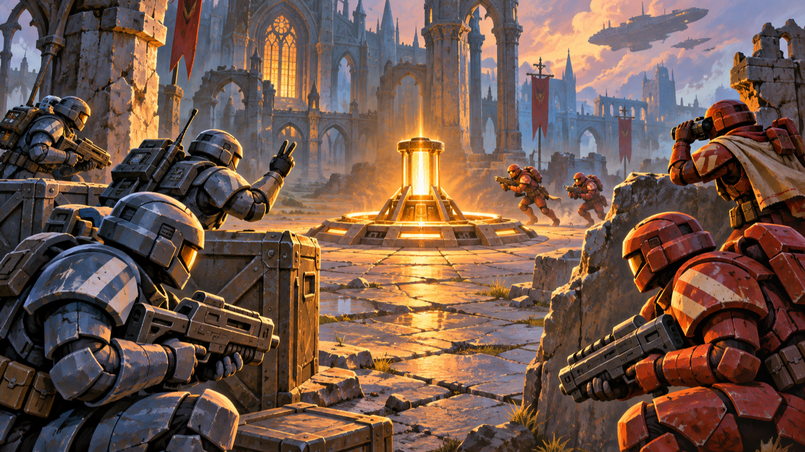
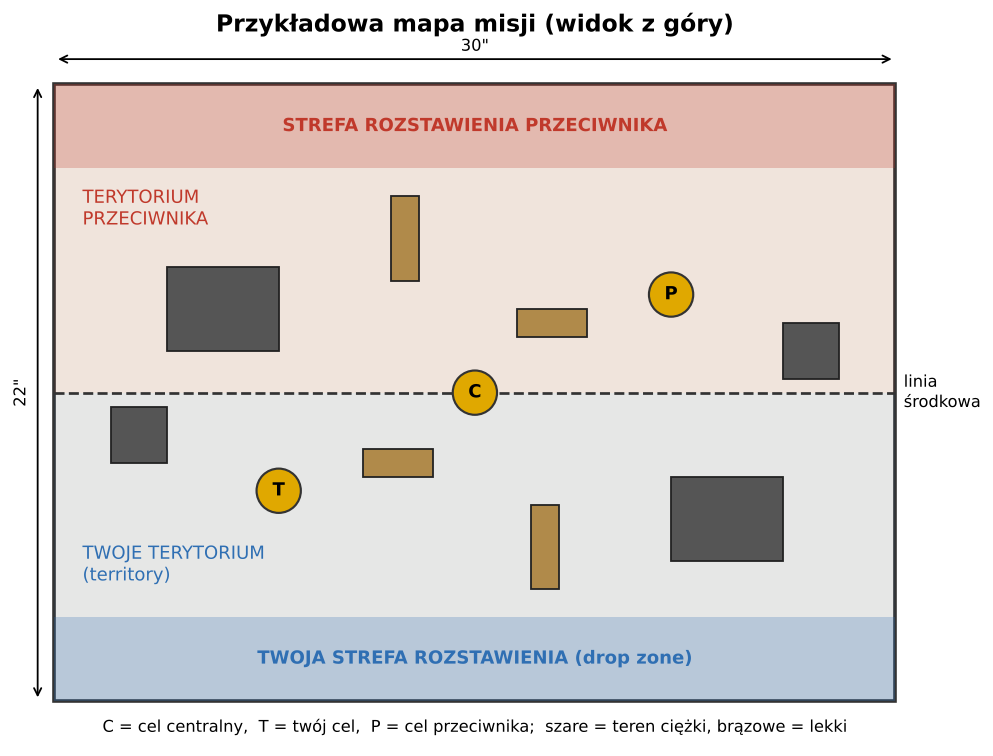
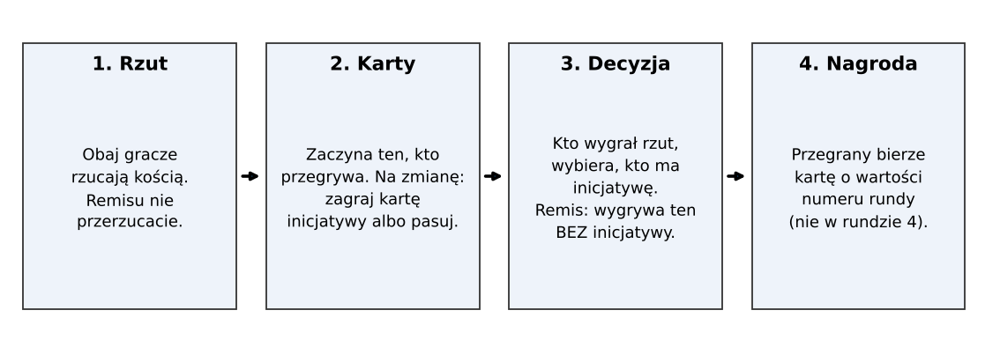
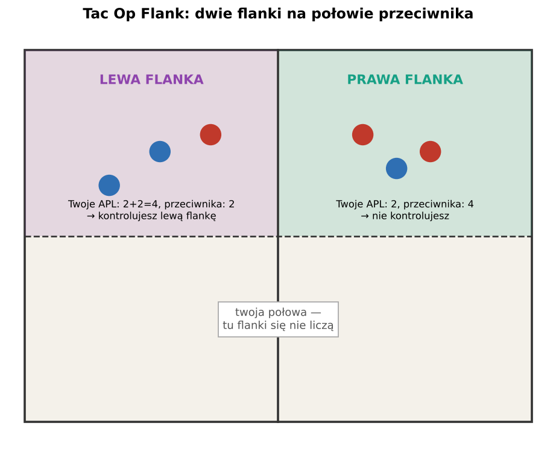

# Część 2 — Misje

**Jak przygotować bitwę, zdobywać punkty i wygrywać**

[← Zasady podstawowe](01_zasady_podstawowe.md) · [Spis podręcznika](README.md) · Następna część: [Sprzęt →](03_sprzet.md)

Ta część opisuje misje z pakietu **Approved Ops 2025** (Zatwierdzone operacje 2025). To talia kart z misjami, w którą gra się na turniejach i w większości klubów. Jeśli chcesz zagrać prościej — na przykład pierwszą grę albo grę we trzech — zajrzyj do [części 5 — Inne tryby gry](05_inne_tryby_gry.md).

> ⚠️ **Uwaga:** Pełne teksty kart Approved Ops są tylko w płatnej talii i w aplikacji Kill Team. Opisy kart w tej części są **skrócone** i oparte na oficjalnych poprawkach oraz recenzjach. Gdy coś jest niejasne, sprawdź dokładne brzmienie na karcie.

---

## Spis treści

1. [Jak się wygrywa?](#1-jak-się-wygrywa)
2. [Słowa, które musisz znać](#2-słowa-które-musisz-znać)
3. [Przygotowanie bitwy krok po kroku](#3-przygotowanie-bitwy-krok-po-kroku)
4. [Inicjatywa i karty inicjatywy](#4-inicjatywa-i-karty-inicjatywy)
5. [Primary Op — operacja główna](#5-primary-op--operacja-główna)
6. [Kill Op — operacja eliminacji](#6-kill-op--operacja-eliminacji)
7. [Crit Ops — operacje krytyczne](#7-crit-ops--operacje-krytyczne)
8. [Tac Ops — operacje taktyczne](#8-tac-ops--operacje-taktyczne)
9. [Przykład: liczymy punkty całej bitwy](#9-przykład-liczymy-punkty-całej-bitwy)
10. [Wskazówki taktyczne](#10-wskazówki-taktyczne)
11. [Najczęstsze pytania o misje](#11-najczęstsze-pytania-o-misje)
12. [Gra na turnieju](#12-gra-na-turnieju)
13. [Źródła](#13-źródła)

---

## 1. Jak się wygrywa?

W Kill Team zwykle **nie wystarczy pokonać wszystkich wrogów**. Wygrywa gracz, który zdobędzie więcej **VP — Victory Points** (Punkty zwycięstwa).

Punkty zdobywasz z **trzech operacji** (ops):

| Operacja | Po polsku | Skąd punkty? | Maksimum |
|---|---|---|---|
| **Crit Op** | Operacja krytyczna | Wspólna dla obu graczy. Zwykle chodzi o znaczniki celu na stole. | 6 VP |
| **Kill Op** | Operacja eliminacji | Za pokonywanie wrogich żołnierzy. | 6 VP |
| **Tac Op** | Operacja taktyczna | Twoje tajne zadanie. Każdy gracz ma swoje. | 6 VP |
| **Primary Op** | Operacja główna | Premia za jedną z trzech operacji, którą wybierzesz na początku. | 3 VP |

Najwięcej można zdobyć **21 VP** (6 + 6 + 6 + 3).

**Gra trwa 4 rundy.** Po czwartej rundzie gracze liczą punkty. Kto ma więcej, wygrywa. Przy równej liczbie punktów jest remis.

Jeśli jednemu graczowi zginą wszyscy żołnierze, bitwa się nie kończy! Drugi gracz rozgrywa dalej wszystkie pozostałe rundy i może zdobywać kolejne punkty.

> 💡 **Wskazówka:** Bardzo często wygrywa nie ten, kto więcej zabił, tylko ten, kto lepiej pilnował celów misji i wykonał swoje tajne zadanie.

---

## 2. Słowa, które musisz znać

- **Killzone** (Strefa walki): stół do gry z terenem. Zwykle 30" × 22".
- **Mission map** (Mapa misji): rysunek na karcie, który pokazuje, gdzie stoi teren, gdzie są strefy rozstawienia i znaczniki celu.
- **Drop zone** (Strefa rozstawienia): miejsce, w którym ustawiasz swoich żołnierzy przed bitwą.
- **Territory** (Terytorium): twoja połowa stołu — ta, na której jest twoja strefa rozstawienia. Druga połowa to **terytorium przeciwnika**.
- **Centreline** (Linia środkowa): linia dzieląca stół na dwa terytoria.
- **Killzone edge** (Krawędź stołu): brzeg stołu. **Twoja krawędź** to ta przy twojej strefie rozstawienia. **Neutral edge** (Krawędź neutralna) to boczna krawędź, która nie należy do nikogo.
- **Objective marker** (Znacznik celu): okrągły żeton o średnicy 40 mm. Na mapach misji zwykle są trzy: **twój** (na twojej połowie), **przeciwnika** (na jego połowie) i **centralny**.
- **Contest** (Walczyć o cel): twój żołnierz walczy o znacznik, gdy ten jest w jego zasięgu kontroli.
- **Control** (Kontrolować cel): kontrolujesz znacznik, gdy suma APL twoich żołnierzy, którzy walczą o niego, jest **większa** niż suma APL żołnierzy przeciwnika. Przy remisie nikt go nie kontroluje.
- **Mission action** (Akcja misji): specjalna akcja z karty misji, na przykład *Secure* albo *Download*. Wykonuje się ją jak każdą inną akcję i płaci za nią AP.
- **Strategic Gambit** (Zagrywka strategiczna): coś, co robisz w kroku *Gambit* fazy strategii. Niektóre misje dodają własne zagrywki strategiczne — na przykład wybór operacji głównej.

---

## 3. Przygotowanie bitwy krok po kroku

### Krok 1. Set Up the Battle (Przygotuj pole bitwy)

1. **Każdy gracz wybiera swój kill team** (oddział).
2. **Wybierzcie killzone i mapę.** Ułóżcie teren dokładnie tak, jak na mapie. Ustalcie, jakiego typu jest każdy kawałek terenu (Heavy, Light, Vantage itd. — patrz [część 4](04_strefy_walki.md)).
3. **Wybierzcie jedną wspólną Crit Op.** Ustawcie znaczniki celu tak, jak pokazuje mapa. Znaczniki stawia się na podłodze stołu (wyjątek: Killzone Bheta-Decima).
4. **Rzut porównawczy.** Zwycięzca decyduje, kto ma inicjatywę.
5. **Gracz z inicjatywą wybiera strefę rozstawienia.** Przeciwnik dostaje drugą strefę i **kartę Re-roll** (Przerzut inicjatywy) — jako rekompensatę.

### Krok 2. Select Operatives (Wybierz żołnierzy)

1. **Każdy gracz w tajemnicy wybiera żołnierzy** zgodnie z zasadami swojego oddziału (ile i jakich może wziąć). Potem obaj pokazujecie wybór jednocześnie.
2. **Każdy gracz w tajemnicy wybiera do 4 opcji sprzętu** (equipment). Każdą opcję można wziąć tylko raz. Pokazujecie jednocześnie. Opis sprzętu jest w [części 3](03_sprzet.md).
3. **Każdy gracz dostaje 2 CP** na start.
4. **Każdy gracz w tajemnicy wybiera jedną Tac Op.** Musi pochodzić z jednego z **archetypów** (rodzajów zadań) przypisanych jego oddziałowi. Archetypy są cztery: *Infiltration*, *Recon*, *Security* i *Seek & Destroy*. Które z nich ma twój oddział, sprawdzisz w jego zasadach.

### Krok 3. Set Up Operatives (Ustaw żołnierzy)

1. **Sprzęt ustawiany przed bitwą** (np. drabiny, barykady, miny): gracze ustawiają go na zmianę, **po jednym przedmiocie**, zaczynając od gracza z inicjatywą.
2. **Żołnierze:** gracze na zmianę ustawiają po **jednej trzeciej** swojego oddziału (zaokrąglając w górę), zaczynając od gracza z inicjatywą. Każdy żołnierz musi stać **całkowicie w swojej strefie rozstawienia** i dostaje rozkaz **Conceal**.

> **Przykład:** Masz 10 żołnierzy. Jedna trzecia z 10 to 3,33, czyli po zaokrągleniu 4. Ustawiasz najpierw 4, potem przeciwnik swoją grupę, potem ty kolejne 4, potem on, a na końcu ty ostatnich 2.

> 💡 **Wskazówka:** Ten, kto ustawia jako drugi, widzi, gdzie stanął przeciwnik. Dlatego najważniejszych żołnierzy warto ustawiać w ostatniej grupie.

### Krok 4. Play the Battle (Rozegraj bitwę)

Gracie 4 rundy według [zasad podstawowych](01_zasady_podstawowe.md#7-przebieg-rundy). Approved Ops dodają dwie rzeczy:

- **karty inicjatywy** w każdej rundzie (rozdział 4),
- **wybór operacji głównej** w pierwszej rundzie (rozdział 5).

### Krok 5. End the Battle (Zakończ bitwę)

1. Po 4 rundach obaj gracze jednocześnie pokazują swoją operację główną i dodają premię.
2. Kto ma więcej VP, wygrywa. Przy równej liczbie — remis.

---

## 4. Inicjatywa i karty inicjatywy

W Approved Ops rzut o inicjatywę na początku każdej rundy (także pierwszej) wygląda tak:

1. **Rzut porównawczy.** Obaj gracze rzucają kością. **Remisu nie przerzucacie.**
2. **Karty.** Zaczynając od gracza, który **przegrywa** rzut, gracze na zmianę zagrywają **jedną kartę inicjatywy** albo pasują. Kończy się, gdy obaj spasują jeden po drugim.
   - Najpierw rozpatruje się zasady oddziałów, które zmieniają ten rzut. Dopiero potem karty.
3. **Decyzja.** Gracz z wyższym wynikiem decyduje, kto ma inicjatywę. **Przy remisie wygrywa gracz, który teraz nie ma inicjatywy.**
4. **Nagroda pocieszenia.** Gracz, który przegrał rzut, dostaje kartę inicjatywy o wartości **numeru rundy**. W rundzie 4 nie dostaje się już karty.

### Karty inicjatywy

- **Re-roll** (Przerzut): przerzuć swoją kość. Nowy wynik zastępuje stary — razem ze wszystkimi wcześniejszymi zmianami z kart.
- **+1/−1**, **+2/−2**, **+3/−3** (Zmiana wyniku): dodaj albo odejmij tę liczbę od wyniku rzutu. Wynik może być większy niż 6 albo mniejszy niż 1. Na przykład 5 z kartą +2/−2 może zmienić się w 3 albo w 7.

Każdą kartę zagrywa się jeden raz. Karty, których nie użyjesz, możesz trzymać na później.

| Runda | Kartę dostaje… | Wartość karty |
|---|---|---|
| Przed bitwą | gracz, który nie wybrał strefy rozstawienia | Re-roll |
| 1 | przegrany rzutu | +1/−1 |
| 2 | przegrany rzutu | +2/−2 |
| 3 | przegrany rzutu | +3/−3 |
| 4 | nikt | — |

> **Przykład:** Jest runda 3. Przeciwnik miał inicjatywę w rundzie 2, a ty zbierałeś karty z przegranych rzutów. Wyrzucasz 2, a przeciwnik 5. Przegrywasz, więc zaczynasz. Zagrywasz kartę **+2/−2** i zmieniasz swoje 2 na 4. Przeciwnik pasuje. Zagrywasz jeszcze **+1/−1** i zmieniasz 4 na 5. Przeciwnik nie ma kart, więc znów pasuje, a ty też pasujesz. Jest remis 5:5. Inicjatywę ma teraz przeciwnik, więc remis wygrywasz ty! Decydujesz, kto ma inicjatywę w tej rundzie.

> 💡 **Wskazówka:** Inicjatywa jest najważniejsza w rundach 2–4, bo wtedy liczy się, kto pierwszy dobiegnie do celu albo kto pierwszy strzeli. Nie wydawaj wszystkich kart w pierwszej rundzie.

> 💡 **Wskazówka:** Inicjatywa to nie zawsze zaleta. Gracz bez inicjatywy dostaje **2 CP** zamiast 1, a jego ostatni żołnierz rusza się jako ostatni w rundzie — może zająć cel, gdy przeciwnik nie ma już czym odpowiedzieć.

---

## 5. Primary Op — operacja główna

W pierwszej rundzie, w kroku *Gambit*, każdy gracz **w tajemnicy** wybiera jedną z trzech operacji jako swoją **Primary Op** (Operację główną):

1. Crit Op,
2. Kill Op,
3. Tac Op.

Najprościej zapisać wybór na kartce albo odłożyć zakrytą kartę z numerem.

Na końcu bitwy obaj gracze jednocześnie pokazują wybór. Każdy dostaje **dodatkowe punkty równe połowie punktów zdobytych z tej operacji, zaokrąglonej w górę**.

| VP z operacji głównej | 0 | 1 | 2 | 3 | 4 | 5 | 6 |
|---|---|---|---|---|---|---|---|
| Premia | 0 | 1 | 1 | 2 | 2 | 3 | 3 |

> **Przykład:** Wybrałeś Tac Op jako operację główną i zdobyłeś z niej 5 VP. Połowa z 5 to 2,5, po zaokrągleniu w górę 3. Dostajesz **3 dodatkowe VP**.

> 💡 **Jak wybierać?**
> - **Kill Op** — gdy twój oddział jest mocny w walce, a przeciwnik ma mało żołnierzy.
> - **Tac Op** — gdy twoje tajne zadanie dobrze pasuje do mapy i do twojego oddziału.
> - **Crit Op** — gdy umiesz utrzymać cele i przeciwnik raczej cię z nich nie zepchnie.
> - Pamiętaj, że premia 3 VP jest już przy 5 VP z operacji — nie musisz zdobyć pełnych 6.

---

## 6. Kill Op — operacja eliminacji

Kill Op nagradza za pokonywanie wrogów. Działa w ten sam sposób w każdej misji.

- Każdy gracz zaczyna z **kill grade 0** (poziomem eliminacji 0).
- Gdy wyeliminujesz odpowiednią liczbę wrogów, twój poziom rośnie. Najwyższy poziom to **5**.
- **Za każdy nowy poziom dostajesz 1 VP.**
- **Na końcu bitwy**, jeśli masz **wyższy** poziom eliminacji niż przeciwnik, dostajesz jeszcze **1 VP**.

Ile wrogów trzeba pokonać, żeby wejść na kolejny poziom, zależy od tego, **ilu żołnierzy przeciwnik miał na początku bitwy**. Dzięki temu gra jest uczciwa: pokonanie 2 z 5 elitarnych wojowników jest tak samo cenne jak pokonanie 4 z 10 zwykłych żołnierzy.

### Tabela poziomów eliminacji

Dokładna tabela jest na karcie **Kill Op** w talii Approved Ops i w aplikacji Kill Team. Przepisz ją tutaj, żeby mieć ją zawsze pod ręką:

| Wrogów na początku | Poziom 1 | Poziom 2 | Poziom 3 | Poziom 4 | Poziom 5 |
|---|---|---|---|---|---|
| 5 | | | | | |
| 6 | | | | | |
| 7 | | | | | |
| 8 | 2 | 3 | | | |
| 9 | | | | | |
| 10 | | | | | |
| 11 | | | | | |
| 12 | | | | | |
| 13 | | | | | |
| 14 | | | | | |

W tabeli są wpisane tylko wartości potwierdzone w oficjalnym przykładzie: przy 8 wrogach poziom 1 osiągasz po 2 eliminacjach, a poziom 2 po 3. Resztę uzupełnij z karty.

> 💡 **Wskazówka:** Kill Op to jedyna operacja, w której przeciwnik może ci odebrać szansę na punkty, po prostu chowając się. Dobrze ukryty oddział z rozkazem Conceal jest bardzo trudny do zabicia.

---

## 7. Crit Ops — operacje krytyczne

Crit Op to wspólne zadanie dla obu graczy. Zwykle chodzi w nim o **znaczniki celu**: trzeba je kontrolować albo wykonywać przy nich akcje misji.

### Zasady wspólne dla wszystkich Crit Ops

- Z jednej Crit Op można zdobyć **najwyżej 6 VP** w całej bitwie.
- Większość Crit Ops daje punkty **na końcu każdej rundy od drugiej**. W pierwszej rundzie zwykle nie zdobywa się punktów — to czas na zajęcie pozycji.
- Akcji misji zwykle **nie można wykonywać w zasięgu kontroli wroga**. Najpierw trzeba odepchnąć albo pokonać wroga przy celu.
- Aby wykonać akcję misji przy znaczniku, zwykle musisz go **kontrolować**.

Talia ma **9 Crit Ops**. Na turniejach dzieli się je na trzy grupy (rozdział 12).

### 1. Secure (Zabezpieczenie)

- **Akcja Secure** (Zabezpiecz), 1 AP: zabezpieczasz znacznik, który kontrolujesz. Pozostaje on twój, dopóki przeciwnik nie zabezpieczy go z powrotem.
- Nie w pierwszej rundzie, nie w zasięgu kontroli wroga.
- **Punkty** na końcu każdej rundy od drugiej:
  - 1 VP, jeśli masz choć jeden zabezpieczony znacznik,
  - 1 VP, jeśli masz więcej zabezpieczonych znaczników niż przeciwnik.

> 💡 Zabezpieczony znacznik zostaje twój, nawet gdy odejdziesz. Możesz zabezpieczyć cel i biec dalej.

### 2. Loot (Grabież)

- **Akcja Loot** (Ograb), 1 AP: przeszukujesz znacznik, który kontrolujesz.
- Nie w pierwszej rundzie, nie w zasięgu kontroli wroga i nie na znaczniku, który już ktoś ograbił w tej rundzie.
- **Punkty:** 1 VP za każdą akcję Loot, **najwyżej 2 VP na rundę**.

> 💡 Liczy się, kto pierwszy dobiegnie. Inicjatywa jest tu bardzo cenna.

### 3. Transmission (Transmisja)

- **Akcja Initiate Transmission** (Rozpocznij transmisję), 1 AP: znacznik, który kontrolujesz, nadaje sygnał do początku następnej rundy.
- Nie w pierwszej rundzie, nie w zasięgu kontroli wroga.
- **Punkty** na końcu każdej rundy od drugiej:
  - 1 VP, jeśli kontrolujesz choć jeden nadający znacznik,
  - 1 VP, jeśli kontrolujesz więcej nadających znaczników niż przeciwnik.

> 💡 Różnica w porównaniu z Secure: tu musisz **nadal kontrolować** znacznik na końcu rundy.

### 4. Orb (Kula)

- Na początku bitwy **kula** leży na znaczniku centralnym.
- **Akcja Move Orb** (Przesuń kulę), 1 AP: jeśli kula jest na twoim znaczniku, przenosisz ją na środek. Jeśli jest na środku — na znacznik przeciwnika.
- **Punkty** od końca drugiej rundy: każdy znacznik **bez kuli** daje 1 VP graczowi, który go kontroluje.

> 💡 Kula „wyłącza” znacznik, na którym leży. Wypchnij ją na stronę przeciwnika, a sam pilnuj swojego celu i środka.

### 5. Stake Claim (Zaklepanie terenu)

- Od drugiej rundy, w kroku *Gambit* każdej rundy, wybierasz jeden znacznik i jeden warunek:
  - na końcu rundy **ty go kontrolujesz**, albo
  - na końcu rundy **wrogowie nie walczą** o ten znacznik.
- Każdy znacznik możesz wybrać tylko raz w całej bitwie.
- **Punkty** na końcu każdej rundy od drugiej:
  - 1 VP, jeśli wybrany warunek się spełnił,
  - 1 VP, jeśli kontrolujesz **większość** znaczników.

> 💡 Musisz zaplanować z góry, który cel weźmiesz w której rundzie. Przeciwnik widzi twój wybór — spodziewaj się, że tam pobiegnie.

### 6. Energy Cells (Ogniwa energetyczne)

- Od drugiej rundy znaczniki celu można podnosić, ale akcja **Pick Up Marker** kosztuje więcej:
  - w rundzie 2: **+2 AP**,
  - w rundzie 3: **+1 AP**,
  - w rundzie 4: zwykły koszt.
  - Tego kosztu nie da się zmniejszyć.
- Żołnierz, który niesie znacznik, nie może przejść więcej niż **6" w rundzie**.
- **Punkty** na końcu każdej rundy od drugiej:
  - 1 VP, jeśli kontrolujesz więcej znaczników niż przeciwnik,
  - 1 VP, jeśli twoi żołnierze niosą jakikolwiek znacznik.

> 💡 Żołnierz z APL 2 nie podniesie znacznika w rundzie 2, bo kosztuje to 3 AP. Żołnierz z APL 3 — tak!

### 7. Download (Pobieranie danych)

- **Akcja Download** (Pobierz dane), 1 AP: na znaczniku centralnym albo znaczniku przeciwnika. **Tylko w rundach 3 i 4.** Nie na znaczniku, z którego już pobrano dane.
- Pobrany znacznik pozostaje pobrany do końca bitwy.
- **Punkty:**
  - od końca drugiej rundy: 1 VP, jeśli kontrolujesz **większość** znaczników (nie licząc pobranych),
  - za Download w rundzie 3: **1 VP**,
  - za Download w rundzie 4: **2 VP**.

### 8. Data (Dane)

- **Akcja Compile Data** (Zbierz dane), 1 AP: przy znaczniku. Na każdym znaczniku można ją wykonać raz na rundę — robi to ten gracz, który zdąży pierwszy. Każda akcja dodaje dane do znacznika.
- **Punkty:**
  - od końca drugiej rundy: 1 VP dla gracza, który wykonał więcej akcji Compile Data,
  - w rundzie 4 — **akcja Send Data** (Wyślij dane), 1 AP: dostajesz tyle VP, ile danych jest zebranych na tym znaczniku.
- Najwyżej **6 VP** z tej operacji.

> 💡 Zbieraj dane przez całą grę, a w ostatniej rundzie wyślij je ze znacznika, na którym jest ich najwięcej.

### 9. Reboot (Restart)

- W pierwszej rundzie, w kroku *Gambit*, obaj gracze w tajemnicy wybierają jeden ze znaczników 1–3.
  - Jeśli wybraliście **różne** znaczniki: wyłączony (*inert*) staje się ten, którego **nikt nie wybrał**.
  - Jeśli wybraliście **ten sam**: wyłączony staje się właśnie ten.
- **Akcja Reboot** (Uruchom ponownie), 2 AP: włącza wyłączony znacznik. Wystarczy wykonać ją raz.
- **Punkty** od końca drugiej rundy: 1 VP za każdy kontrolowany znacznik, który **nie jest wyłączony**.

---

## 8. Tac Ops — operacje taktyczne

Tac Op to twoje **tajne zadanie**. Przeciwnik nie wie, co wybrałeś, dopóki go nie odkryjesz.

### Jak to działa?

- Przed bitwą wybierasz **jedną** Tac Op z archetypów swojego oddziału.
- Każda karta Tac Op mówi, **kiedy ją odkryć** — zwykle wtedy, gdy pierwszy raz zdobywasz z niej punkty albo wykonujesz jej akcję.
- Z Tac Op można zdobyć **najwyżej 6 VP**.
- Większość Tac Ops daje punkty **od końca drugiej rundy**.

### Cztery archetypy

| Archetyp | Po polsku | O co chodzi? |
|---|---|---|
| **Recon** | Zwiad | Rozpoznanie terenu, obserwacja wroga, zdobywanie przedmiotów. |
| **Security** | Ochrona | Utrzymywanie pozycji i znaków na połowie wroga. |
| **Seek & Destroy** | Znajdź i zniszcz | Pokonywanie wrogów w określonych miejscach. |
| **Infiltration** | Infiltracja | Skradanie się, śledzenie wroga, podkładanie urządzeń. |

Każdy oddział ma w swoich zasadach zwykle dwa archetypy. Każdy archetyp ma 3 Tac Ops, razem jest ich 12.

### Recon (Zwiad)

**Flank** (Flanka)

- Stół dzieli się na **lewą i prawą flankę** linią, która biegnie przez środek stołu od twojej krawędzi do krawędzi przeciwnika.
- Twój żołnierz walczy o flankę, jeśli stoi **całkowicie w niej i na połowie przeciwnika**.
- Flankę kontroluje gracz, którego żołnierze mają tam **większą sumę APL**.
- **Punkty** od końca drugiej rundy: 1 VP za każdą kontrolowaną flankę.

**Retrieval** (Odzyskiwanie)

- **Akcja Retrieve** (Odzyskaj), 1 AP: przy znaczniku celu. Każdy znacznik można przeszukać tylko raz w bitwie. Żołnierz dostaje wtedy znacznik przedmiotu i go niesie.
- **Punkty:** 1 VP za każdą akcję Retrieve, a na końcu bitwy 1 VP za każdy przedmiot, który niosą twoi żołnierze.

**Scout Enemy Movement** (Śledzenie ruchów wroga)

- **Akcja Scout** (Obserwuj), 1 AP: tylko żołnierz z rozkazem **Conceal**. Wybierz widocznych, gotowych (Ready) wrogów, którzy są **dalej niż 6"**. Stają się obserwowani do następnego kroku *Ready*.
- **Punkty** od końca drugiej rundy: 1 VP za każdego obserwowanego wroga, którego widzą twoi żołnierze — **najwyżej 2 VP na rundę**.

### Security (Ochrona)

**Envoy** (Wysłannik)

- Od drugiej rundy wybierasz swojego **wysłannika**. W każdej rundzie musi to być ktoś inny.
- **Punkty** na końcu rundy:
  - 1 VP, jeśli wysłannik stoi **całkowicie na połowie przeciwnika** i nie jest w zasięgu kontroli wroga,
  - +1 VP, jeśli wysłannik nie stracił żadnej rany.

**Plant Banner** (Zatknięcie sztandaru)

- **Akcja Plant Banner** (Zatknij sztandar), 1 AP: raz na bitwę, całkowicie na połowie przeciwnika i w odpowiedniej odległości od bocznych krawędzi stołu (dokładnie — na karcie).
- **Punkty** od końca drugiej rundy:
  - 1 VP, jeśli sztandar jest całkowicie na połowie przeciwnika,
  - +1 VP, jeśli żaden wróg nie walczy o sztandar.
- Sztandar może podnieść **każdy** gracz — przeciwnik też może go zabrać!

**Martyrs** (Męczennicy)

- Gdy twój żołnierz zostanie wyeliminowany, walcząc o znacznik celu, połóż przy tym znaczniku **żeton męczennika**.
  - Liczy się tylko **pierwsze** wyeliminowanie danego żołnierza (dotyczy oddziałów, które mogą wrócić do gry).
  - Żeton kładziesz nawet wtedy, gdy żołnierza nie pokonał wróg — na przykład gdy zginął od własnego granatu albo miny.
- **Punkty** od końca drugiej rundy: zdejmij dowolną liczbę swoich żetonów męczennika — 1 VP za każdy, a +1 VP, jeśli kontrolujesz ten znacznik. **Najwyżej 2 VP na rundę.**

### Seek & Destroy (Znajdź i zniszcz)

**Rout** (Pogrom)

- Za każdego wroga, którego pokonasz **w odległości do 6" od jego strefy rozstawienia**: 1 VP.
- Jeśli ten wróg miał **12 lub więcej ran** (Wounds): 2 VP.
- Karta ma ograniczenia, w których rundach to działa — sprawdź na karcie.

**Sweep & Clear** (Przeczesanie i oczyszczenie)

- Gdy pokonasz wroga, który walczył o znacznik celu, połóż na tym znaczniku swój **żeton Swept** (Przeczesany).
- **Akcja Clear** (Oczyść), 1 AP: oczyszczasz znacznik celu.
- **Punkty** na końcu każdej rundy od drugiej:
  - 1 VP, jeśli przynajmniej jeden oczyszczony znacznik (nie twój własny) nie jest kontestowany przez wrogów — **2 VP**, jeśli ten znacznik ma też twój żeton Swept,
  - osobno: 1 VP, jeśli kontrolujesz znacznik z twoim żetonem Swept.

**Dominate** (Dominacja)

- Gdy twój żołnierz pokona wroga, dostaje **żeton dominacji**. Jeśli wróg miał **12 lub więcej ran**, twój żołnierz dostaje **dwa** żetony.
- **Punkty** na końcu rundy 3 i rundy 4: zdejmij żetony — 1 VP za każdy, **najwyżej 3 VP na rundę**.

> 💡 Żetony należą do żołnierza, który pokonał wroga. Pilnuj tego żołnierza do końca rundy 3!

### Infiltration (Infiltracja)

**Track Enemy** (Tropienie wroga)

- Wróg jest **tropiony**, jeśli:
  - twój żołnierz z rozkazem **Conceal** jest do 6" od niego, ale nie w jego zasięgu kontroli,
  - a twój żołnierz **nie jest prawidłowym celem** dla tego wroga (np. stoi w osłonie).
- **Punkty** od końca drugiej rundy: 1 VP za każdego tropionego wroga. W ostatniej rundzie punktacja jest wyższa — sprawdź na karcie.

**Plant Devices** (Podłożenie urządzeń)

- **Akcja Plant Device** (Podłóż urządzenie), 1 AP: na znaczniku, który kontrolujesz.
- **Punkty** na końcu każdej rundy:
  - 1 VP za urządzenie na **znaczniku przeciwnika**,
  - 1 VP za każdy inny znacznik z urządzeniem, o który walczą wrogowie.
  - **Najwyżej 2 VP na rundę.**

**Steal Intelligence** (Kradzież informacji)

- Gdy pokonasz wroga, połóż **znacznik informacji** w jego zasięgu kontroli.
- Twoi żołnierze mogą je podnosić. Jeden żołnierz może nieść **najwyżej dwa**.
- **Punkty:**
  - na końcu każdej rundy: 1 VP, jeśli któryś twój żołnierz niesie znacznik informacji,
  - na końcu ostatniej rundy: 1 VP za każdy niesiony znacznik informacji.

---

## 9. Przykład: liczymy punkty całej bitwy

Ola gra oddziałem z 10 żołnierzami. Kuba gra oddziałem z 6 elitarnymi wojownikami. Grają **Crit Op: Secure**.

- **Ola** wybrała Tac Op **Plant Banner**, a operację główną **Crit Op**.
- **Kuba** wybrał Tac Op **Dominate**, a operację główną **Kill Op**.

| Runda | Ola | Kuba |
|---|---|---|
| 1 | Zajmuje pozycje. Punktów jeszcze nie ma. | Zajmuje pozycje. |
| 2 | Secure: ma zabezpieczony cel (+1) i więcej celów niż Kuba (+1). Sztandar stoi na połowie Kuby (+1). **Razem 3** | Pokonuje 2 żołnierzy Oli: Kill Op poziom 1 (+1). Żetony dominacji jeszcze się nie liczą. **Razem 1** |
| 3 | Secure (+1). Sztandar (+1), nikt przy nim nie walczy (+1). Kill Op: wchodzi od razu na poziom 2 (+2). **Razem 5** | Secure (+1). Kill Op poziom 2 (+1). Zdejmuje 3 żetony dominacji (+3). **Razem 5** |
| 4 | Secure (+1) i więcej celów (+1). Sztandar (+1), nikt przy nim nie walczy (+1). **Razem 4** | Kill Op poziom 3 (+1). Zdejmuje 1 żeton (+1). **Razem 2** |

**Suma po 4 rundach:**

- **Ola:** Crit Op 5, Tac Op 5, Kill Op 2 = **12 VP**.
- **Kuba:** Crit Op 1, Tac Op 4, Kill Op 3 = **8 VP**.

**Dodatkowy punkt z Kill Op:** Kuba skończył na poziomie eliminacji 3, a Ola na poziomie 2. Kuba ma wyższy poziom, więc dostaje **+1 VP**. Teraz ma Kill Op 4 i razem **9 VP**.

**Premia za operację główną:**

- Ola: Crit Op dała 5 VP → premia **3**. Razem **15 VP**.
- Kuba: Kill Op dała 4 VP → premia **2**. Razem **11 VP**.

**Wygrywa Ola 15:11**, choć pokonała mniej wrogów niż Kuba.

> Liczby w tym przykładzie są wymyślone, żeby pokazać sposób liczenia. W prawdziwej grze poziomy eliminacji sprawdzasz w tabeli z karty Kill Op.

---

## 10. Wskazówki taktyczne

1. **Przeczytaj misję przed wystawieniem.** Zanim ustawisz żołnierzy, pomyśl, gdzie będą musieli być w rundzie 2, bo wtedy zaczyna się liczenie punktów.
2. **Pierwsza runda to ustawianie się.** Zwykle nie warto w niej ryzykować. Zajmij dobre pozycje, schowaj się, przygotuj ruch na rundę 2.
3. **Licz APL przy celach.** Jeden Space Marine (APL 3) przegra kontrolę z dwoma zwykłymi żołnierzami (APL 2 + 2 = 4).
4. **Ukrywaj Tac Op jak najdłużej.** Jeśli przeciwnik nie wie, co robisz, nie może ci przeszkodzić.
5. **Obserwuj, co robi przeciwnik.** Jeśli jego żołnierze dziwnie chowają się blisko twoich, może mieć *Track Enemy*. Jeśli biegnie z kimś na twoją połowę — może to *Envoy* albo *Plant Banner*.
6. **Pilnuj, żeby nie dawać przeciwnikowi łatwych punktów z Kill Op.** Ranni żołnierze z rozkazem Conceal za ciężkim terenem są bezpieczni.
7. **Planuj ostatnią aktywację.** W rundzie 4 punkty liczy się na końcu, więc żołnierz, który rusza się ostatni, może zdecydować o wyniku.
8. **Nie zapominaj o operacji głównej.** Zanotuj ją! Łatwo zapomnieć w ferworze walki.

---

## 11. Najczęstsze pytania o misje

**Czy mogę zdobyć punkty z Crit Op w pierwszej rundzie?**
Zwykle nie. Większość operacji liczy punkty dopiero od końca rundy 2.

**Co, jeśli wszyscy moi żołnierze zginą w rundzie 3?**
Bitwa trwa dalej. Przeciwnik rozgrywa rundę 4 sam i może zdobywać punkty. Ty zachowujesz punkty zdobyte wcześniej i dostajesz premię za operację główną.

**Czy żołnierz niosący znacznik celu może go kontrolować i jednocześnie walczyć o inny znacznik?**
Niesiony znacznik kontroluje tylko on. O inne znaczniki walczy normalnie.

**Czy przy kontroli celu liczy się żołnierz w rozkazie Conceal?**
Tak. Rozkaz nie ma znaczenia. Liczy się tylko zasięg kontroli (1" i widoczność) oraz APL.

**Czy żeton męczennika (Martyrs) dostaję, gdy żołnierz zginie od mojej własnej miny?**
Tak — według oficjalnego wyjaśnienia z kwietnia 2026.

**Ile żetonów dominacji dostaję za pokonanie wielkiego wroga?**
Dwa, jeśli wróg miał 12 lub więcej ran (poprawka z kwietnia 2026).

**Czy muszę mówić przeciwnikowi, jaką wybrałem operację główną?**
Nie. Pokazujecie ją dopiero na końcu bitwy.

**Mój oddział ma tylko archetypy Recon i Infiltration. Czy mogę wybrać Rout?**
Nie. Tac Op musi pochodzić z jednego z archetypów twojego oddziału.

---

## 12. Gra na turnieju

Jeśli kiedyś pojedziesz na turniej, przydadzą się te zasady z oficjalnego **Tournament Companion** (Przewodnika turniejowego):

- **Wszyscy gracze grają tę samą Crit Op** w danej rundzie turnieju.
- Organizator wybiera po jednej Crit Op z każdej grupy, żeby było różnorodnie:
  - **Grupa A:** 1. Secure, 2. Loot, 3. Transmission,
  - **Grupa B:** 4. Orb, 6. Energy Cells, 7. Download,
  - **Grupa C:** 5. Stake Claim, 8. Data, 9. Reboot.
- **Remis to prawidłowy wynik.** Dwa remisy są warte tyle co wygrana i przegrana.
- **Ranking:** najpierw bilans (wygrane/przegrane/remisy), potem siła przeciwników, na końcu suma zdobytych VP.
- **Aktualizacje zasad w aplikacji Kill Team są ważniejsze** niż zasady wydrukowane.
- **Format Classified:** na turniejach, w których nagrodą jest bilet na Mistrzostwa Świata (World Championships of Warhammer), można grać tylko oddziałami z aktualnej listy rotacji.

---

## 13. Źródła

- Approved Ops 2025 — opis w Wahapedii: https://wahapedia.ru/kill-team3/the-rules/approved-ops-2025/
- Recenzja Approved Ops 2025 (Goonhammer): https://www.goonhammer.com/goonhammer-reviews-kill-team-approved-ops-2025
- Zapowiedź Approved Ops 2025 (Warhammer Community): https://www.warhammer-community.com/en-gb/articles/mhstieyb/kill-team-approved-ops-2025-snatch-the-initiative-and-secure-new-objectives/
- Approved Ops 2025 Tournament Companion: https://assets.warhammer-community.com/eng_06-05_kt_approved_ops_2025_tournament_companion-9yxtdulpgd-ktlq8bvdto.pdf
- Approved Ops — poprawki z października 2025: https://assets.warhammer-community.com/eng_29-10_kill_team_approved_ops_update_log-ixfwzbnosj-srenm5bixi.pdf
- Approved Ops — poprawki z kwietnia 2026: https://assets.warhammer-community.com/eng_29-04_kill_team_key_downloads_approved_ops_update_log-ojpqmwjxda-z4rtrjne3n.pdf
- Misje z podręcznika (Secure, Loot, Transmission): https://wahapedia.ru/kill-team3/the-rules/the-missions/

[← Zasady podstawowe](01_zasady_podstawowe.md) · [Spis podręcznika](README.md) · Następna część: [Sprzęt →](03_sprzet.md)
