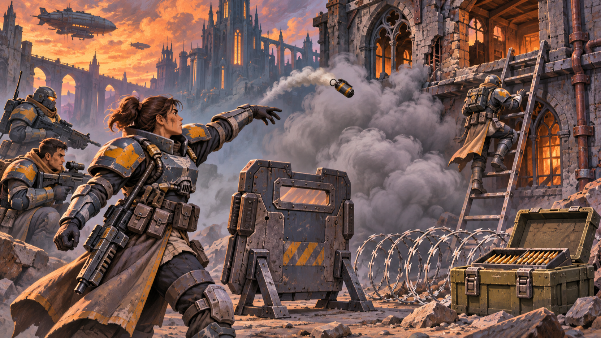

# Część 3 — Sprzęt

**Universal Equipment: granaty, drabiny, barykady i inne przydatne rzeczy**

[← Misje](02_misje.md) · [Spis podręcznika](README.md) · Następna część: [Strefy walki →](04_strefy_walki.md)

Przed bitwą każdy gracz może wybrać dodatkowy **equipment** (sprzęt). Są dwa rodzaje:

- **Universal Equipment** (Sprzęt uniwersalny): może go wziąć **każdy** oddział. Opisujemy go tutaj.
- **Faction equipment** (Sprzęt oddziału): jest w zasadach konkretnego oddziału. Ten opiszemy razem z oddziałami.

Zasady w tej części są aktualne według oficjalnego dokumentu Universal Equipment z wyjaśnieniami z czerwca 2026.

---

## Spis treści

1. [Jak wybierać sprzęt](#1-jak-wybierać-sprzęt)
2. [Sprzęt ustawiany przed bitwą](#2-sprzęt-ustawiany-przed-bitwą)
3. [Granaty](#3-granaty)
4. [Breaching Charge](#4-breaching-charge-ładunek-wyważający)
5. [Który sprzęt wybrać?](#5-który-sprzęt-wybrać)
6. [Najczęstsze pytania o sprzęt](#6-najczęstsze-pytania-o-sprzęt)

---

## 1. Jak wybierać sprzęt

- W misjach Approved Ops każdy gracz wybiera **do 4 opcji sprzętu**. Może mieszać sprzęt uniwersalny i sprzęt swojego oddziału.
- **Każdą opcję możesz wybrać tylko raz.** Niektóre opcje dają kilka sztuk — na przykład opcja *Ladders* to 2 drabiny, a opcja *Explosive Grenades* to 2 granaty.
- Wybór jest tajny. Obaj gracze pokazują go jednocześnie.
- Sprzęt **nie należy do konkretnego żołnierza**. Na przykład granat może rzucić dowolny twój żołnierz — dopóki nie wykorzystasz wszystkich granatów.
- Sprzęt oznaczony tutaj jako **[PRZED BITWĄ]** ustawia się na stole przed wystawieniem żołnierzy. Gracze robią to na zmianę, po jednym przedmiocie, zaczynając od gracza z inicjatywą.

### Ważne słowo: equipment terrain (teren ze sprzętu)

Barykady, drut kolczasty i drabiny to **teren ze sprzętu**. Zwykle trzeba je stawiać **dalej niż 2"** od innego terenu ze sprzętu, od przejść (access points) i od terenu *Accessible* (np. drzwi). Dzięki temu nikt nie zablokuje drzwi barykadą.

---

## 2. Sprzęt ustawiany przed bitwą

### Ladders (Drabiny) — 2 sztuki [PRZED BITWĄ]

- Teren *Insignificant* i *Exposed* — nie daje osłony.
- **Gdzie postawić:** całkowicie na twojej połowie, pionowo przy terenie wysokim **co najmniej 2"**, dalej niż 2" od innego terenu ze sprzętu i dalej niż 1" od drzwi i przejść.
- Przez drabinę można przechodzić, jakby jej nie było, ale nie można na niej skończyć ruchu.
- **Efekt:** raz na akcję, gdy żołnierz wspina się na teren, przy którym stoi drabina, wspinaczka liczy się jako **1"** (zamiast pełnej wysokości) — o ile drabina jest w jego zasięgu kontroli przez całą wspinaczkę.
- **Wyjaśnienie z października 2026:** drabina nie pozwala „wystrzelić” żołnierza na półkę daleko poza jego normalny zasięg w jednym ruchu. Używaj jej zgodnie z intencją — do wspinania się po ścianie, przy której stoi.

> **Przykład:** Budynek ma 4" wysokości. Bez drabiny nie da się na niego wejść jedną wspinaczką (maksimum to 3"). Z drabiną wspinaczka kosztuje tylko 1"!

> 💡 Normalnie każda wspinaczka kosztuje co najmniej 2". Z drabiną tylko 1". To bardzo przyspiesza zajmowanie dachów (*Vantage*).

### Light Barricades (Lekkie barykady) — 2 sztuki [PRZED BITWĄ]

- Teren *Light* (nóżki są *Insignificant* i *Exposed*).
- **Gdzie postawić:** całkowicie na twojej połowie, na podłodze stołu, dalej niż 2" od innego terenu ze sprzętu, przejść i terenu *Accessible*.
- **Do czego:** dodatkowa osłona na otwartej przestrzeni.

### Heavy Barricade (Ciężka barykada) — 1 sztuka [PRZED BITWĄ]

- Teren *Heavy* — daje osłonę i może **zasłaniać** (obscured).
- **Gdzie postawić:** całkowicie do 4" od twojej strefy rozstawienia, na podłodze stołu, dalej niż 2" od innego terenu ze sprzętu, przejść i terenu *Accessible*.
- **Do czego:** bezpieczna kryjówka przy strefie rozstawienia, za którą można się schować przed snajperami.

### Portable Barricade (Przenośna barykada) — 1 sztuka [PRZED BITWĄ]

- Teren *Light*, *Protective* i *Portable* (nóżki są *Insignificant* i *Exposed*).
- **Gdzie postawić:** jak lekką barykadę.
- **Protective** (Ochronna): żołnierz w osłonie tej barykady ma **Save lepszy o 1** (najlepiej 2+).
- **Portable** (Przenośna): daje osłonę tylko żołnierzowi, który jej **dotyka**, i tylko wtedy, gdy osłona przesłania (nóżek nie liczysz).
- **Akcja Move With Barricade** (Idź z barykadą), 1 AP:
  - działa jak Reposition, ale możesz przejść tylko **Move − 2"**,
  - nie możesz się wspinać, zeskakiwać ani skakać,
  - zabierasz barykadę ze stołu, idziesz, a potem stawiasz ją tak, żeby jej dotykać. Nie wolno jej postawić bliżej niż 2" od innego sprzętu, przejść i terenu *Accessible* — jeśli się nie da, barykada znika,
  - nie w zasięgu kontroli wroga i nie w tej samej aktywacji co Fall Back albo Charge.

> 💡 Żołnierz z Save 4+ za przenośną barykadą ma Save 3+ **i** darmową obronę z osłony. To świetna tarcza dla żołnierza, który powoli idzie do celu.

### Razor Wire (Drut kolczasty) — 1 sztuka [PRZED BITWĄ]

- Teren *Exposed* (nie daje osłony) i *Obstructing* (Utrudniający).
- **Gdzie postawić:** całkowicie na twojej połowie, na podłodze stołu, dalej niż 2" od innego terenu ze sprzętu, przejść i terenu *Accessible*.
- **Obstructing:** gdy żołnierz przekracza drut w odległości do 1" od niego, liczy ten odcinek jako **o 1" dłuższy**.
- **Do czego:** spowalnia wrogów, którzy biegną na twoją połowę.

### Mines (Miny) — 1 sztuka [PRZED BITWĄ]

- **Gdzie postawić:** znacznik całkowicie na twojej połowie, dalej niż 2" od innych znaczników, przejść i terenu *Accessible*.
- **Efekt:** gdy **pierwszy raz** jakiś żołnierz znajdzie się w zasięgu kontroli miny (1" i widoczność), zdejmij znacznik i zadaj temu żołnierzowi **D3+3** obrażeń (czyli od 4 do 6).
- ⚠️ Mina rani **każdego** — także twoich żołnierzy!

> 💡 Postaw minę przy przejściu, którym wróg będzie musiał iść do twojego celu.

### Ammo Cache (Skrzynia z amunicją) — 1 sztuka [PRZED BITWĄ]

- **Gdzie postawić:** znacznik całkowicie na twojej połowie.
- **Akcja Ammo Resupply** (Uzupełnij amunicję), **0 AP**: żołnierz, który kontroluje twoją skrzynię, bierze amunicję. Do początku następnej rundy, gdy strzela z broni ze swojej karty, może **przerzucić jedną kość ataku**.
- Nie w zasięgu kontroli wroga. Każdej skrzyni można użyć **raz na rundę**. Nie możesz używać skrzyni przeciwnika.

### Comms Device (Urządzenie łączności) — 1 sztuka [PRZED BITWĄ]

- **Gdzie postawić:** znacznik całkowicie na twojej połowie.
- **Efekt:** dopóki twój żołnierz kontroluje to urządzenie, zasady ze słowem **SUPPORT** (Wsparcie), które działają na przyjaznych żołnierzy w jakiejś odległości, mają zasięg **większy o 3"**.
- Nie możesz używać urządzenia przeciwnika.
- **Do czego:** tylko dla oddziałów, które mają zasady SUPPORT — na przykład dowódcę, który pomaga żołnierzom w odległości 6". Z urządzeniem będzie to 9".

---

## 3. Granaty

### Utility Grenades (Granaty specjalne) — wybierasz 2

Możesz wziąć **2 dymne**, **2 ogłuszające** albo **1 dymny i 1 ogłuszający**. Każdy granat to **akcja unikalna**, którą twój oddział może wykonać tyle razy w całej bitwie, ile granatów danego typu wziąłeś. Żadnego z nich nie można rzucić w zasięgu kontroli wroga.

**Smoke Grenade** (Granat dymny), 1 AP

- Połóż znacznik dymu do **6"** od żołnierza, w miejscu, które widzi (może być też na terenie *Vantage*, który widzi).
- Powstaje chmura dymu: **1" w każdą stronę** od znacznika, nieskończenie wysoka.
- Żołnierz **całkowicie w dymie** jest **zasłonięty** (obscured) dla żołnierzy, którzy są dalej niż 2" od niego — i on też ich widzi jako zasłoniętych.
- Gdy strzelasz do wroga całkowicie w dymie, *Piercing 2* i *Piercing Crits 2* zmieniają się w *Piercing 1* i *Piercing Crits 1*, chyba że jesteś do 2" od celu.
- **Jak długo trwa:** w następnej rundzie, w kroku *Ready*, rzuć D3. Zdejmij dym po tylu zakończonych aktywacjach — albo na końcu rundy, jeśli to nastąpi wcześniej.

> 💡 Dym to sposób na przebiegnięcie przez otwartą przestrzeń. Rzuć dym, a potem przejdź przez niego żołnierzem — strzelcy daleko będą musieli odrzucić sukces i zamienić krytyki w zwykłe trafienia.

**Stun Grenade** (Granat ogłuszający), 1 AP

- Wybierz wroga, którego widzisz, do **6"** od ciebie.
- On i **każdy inny żołnierz** do 1" od niego robi **test ogłuszenia**: rzuć kością. Na **3+** ten żołnierz ma **APL mniejsze o 1** do końca swojej następnej aktywacji.
- ⚠️ „Każdy inny żołnierz” to też twoi żołnierze, jeśli stoją obok!

### Explosive Grenades (Granaty wybuchowe) — wybierasz 2

Możesz wziąć **2 odłamkowe**, **2 przeciwpancerne** albo **po jednym**. Każdy granat to **broń dystansowa**, której twój oddział może użyć tyle razy w bitwie, ile granatów danego typu wziąłeś. Rzucasz go akcją Shoot, jak z każdej broni.

| Nazwa | Atk | Hit | Dmg | Cechy broni |
|---|---|---|---|---|
| **Frag grenade** (Granat odłamkowy) | 4 | 4+ | 2/4 | Range 6", Blast 2", Saturate |
| **Krak grenade** (Granat przeciwpancerny) | 4 | 4+ | 4/5 | Range 6", Piercing 1, Saturate |

- **Frag** trafia cel i wszystkich żołnierzy do 2" od niego, których cel widzi (*Blast 2"*). Dobry na grupę wrogów.
- **Krak** zadaje duże obrażenia jednemu celowi i przebija pancerz (*Piercing 1*). Dobry na wielkiego, opancerzonego wroga.
- Oba mają *Saturate*, więc cel **nie dostaje darmowej obrony z osłony**.

> ⚠️ Pamiętaj: granat odłamkowy trafia też twoich żołnierzy, jeśli stoją obok celu! I nie możesz rzucić granatu do wroga, przy którym w zasięgu kontroli stoi twój żołnierz.

> 💡 Granaty liczą się jak broń z karty? **Nie.** Granat to sprzęt, więc na przykład skrzynia z amunicją (która działa dla broni z karty żołnierza) nie daje przerzutu do granatu.

---

## 4. Breaching Charge (Ładunek wyważający)

- 1 sztuka, nie ustawia się go przed bitwą.
- **Efekt:** raz w bitwie, gdy twój żołnierz wykonuje akcję **Breach** (Wyważenie), może ją wykonać za **1 AP mniej** (ale co najmniej 1 AP) — tak, jakby miał na karcie słowa „breach marker”.
- **Do czego:** tylko na stołach z punktami wyważenia (*breach points*) — na przykład **Killzone: Tomb World**. Na innych stołach jest bezużyteczny.

---

## 5. Który sprzęt wybrać?

To zależy od stołu, misji i twojego oddziału. Kilka podpowiedzi na start:

| Sytuacja | Dobry wybór |
|---|---|
| Stół z wysokimi budynkami (Volkus) | **Ladders** — szybciej na dachy |
| Dużo otwartej przestrzeni | **Light Barricades**, **Smoke Grenades** |
| Przeciwnik ma dużo zwykłych żołnierzy w grupach | **Frag grenades** |
| Przeciwnik ma kilku wielkich, opancerzonych wojowników | **Krak grenades**, **Stun grenades** |
| Twój żołnierz musi powoli iść przez otwartą przestrzeń | **Portable Barricade** |
| Wróg na pewno pobiegnie na twój cel | **Mines**, **Razor Wire** |
| Twój oddział dużo strzela | **Ammo Cache** |
| Tomb World | **Breaching Charge** |

> 💡 Na początek nie przesadzaj z wyborem. Granaty (wybuchowe i specjalne) przydają się prawie w każdej grze i nie trzeba ich nigdzie ustawiać.

---

## 6. Najczęstsze pytania o sprzęt

**Czy mogę wziąć 4 drabiny?**
Nie. Opcję *Ladders* możesz wybrać tylko raz, a daje ona 2 drabiny.

**Czy granat może rzucić żołnierz z rozkazem Conceal?**
Granat wybuchowy to broń dystansowa, więc rzuca się go akcją Shoot — z rozkazem Conceal nie można. Granaty dymny i ogłuszający to osobne akcje, nie Shoot — sprawdź jednak, czy zasady twojego oddziału czegoś nie zmieniają.

**Czy mina wybucha, gdy wróg przejdzie obok niej za ścianą?**
Nie. Mina działa, gdy znajdzie się w **zasięgu kontroli** żołnierza, czyli do 1" **i widoczna**.

**Czy moja przenośna barykada chroni żołnierza, który stoi obok, ale jej nie dotyka?**
Nie. Przenośna barykada daje osłonę tylko żołnierzom, którzy jej dotykają.

**Czy mogę postawić barykadę na dachu?**
Zwykle nie — barykady stawia się na podłodze stołu. Wyjątek: na stole Bheta-Decima sprzęt można stawiać na terenie *Vantage* (patrz [część 4](04_strefy_walki.md)).

---

**Źródła:**
- Universal Equipment — oficjalny dokument (z wyjaśnieniami z czerwca 2026): https://assets.warhammer-community.com/eng_17-06_kill_team_key_downloads_universal_equipment-prsd0j8pih-ikfmigl0za.pdf
- Universal Equipment w Wahapedii: https://wahapedia.ru/kill-team3/the-rules/universal-equipment/
- Aktualizacja z października 2026 (drabiny): https://www.warhammer-community.com/en-gb/articles/k04goqrk/kill-team-october-update/

[← Misje](02_misje.md) · [Spis podręcznika](README.md) · Następna część: [Strefy walki →](04_strefy_walki.md)
