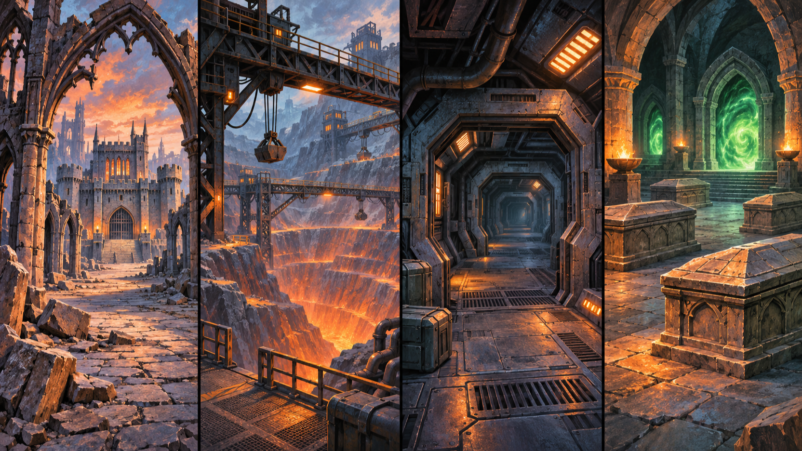
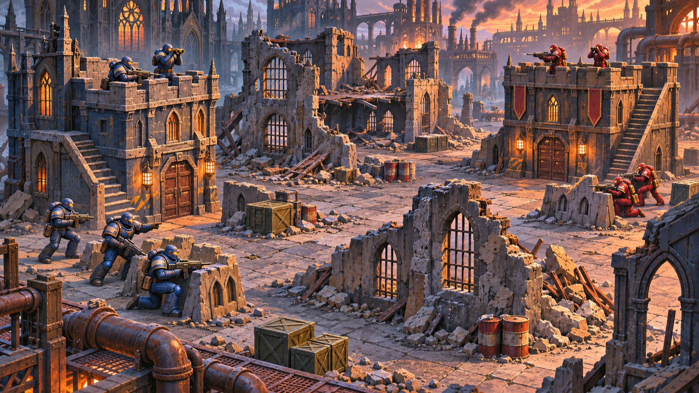
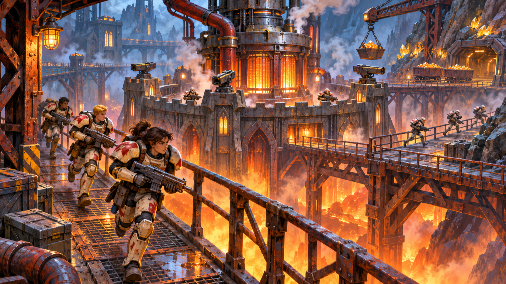
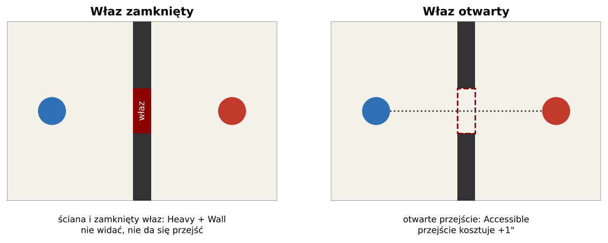
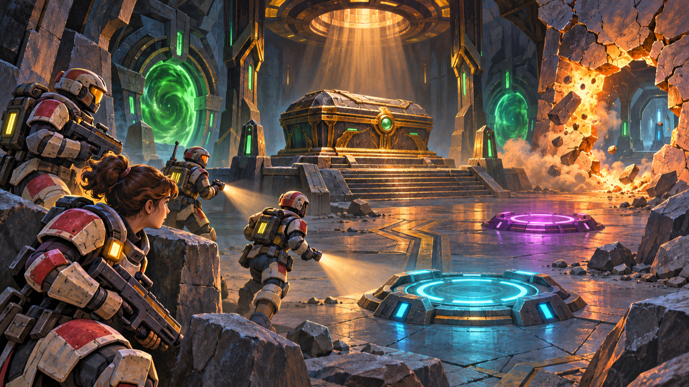

# Część 4 — Strefy walki

**Killzones: na jakich stołach się gra i jakie mają specjalne zasady**

[← Sprzęt](03_sprzet.md) · [Spis podręcznika](README.md) · Następna część: [Inne tryby gry →](05_inne_tryby_gry.md)

**Killzone** (Strefa walki) to stół razem z terenem. Games Workshop wydaje gotowe zestawy terenu, a każdy z nich ma swoje zasady: jaki typ ma każdy kawałek terenu i czasem dodatkowe akcje. Na każdy z tych stołów talia Approved Ops ma **6 map misji**.

Ogólne zasady terenu (Heavy, Light, Vantage, Accessible itd.) są w [części 1, rozdział 16](01_zasady_podstawowe.md#16-rodzaje-terenu). Tutaj opisujemy, co jest specjalnego na każdym stole.

---

## Spis treści

1. [Zanim zaczniesz: części terenu](#1-zanim-zaczniesz-części-terenu)
2. [Killzone: Volkus — zrujnowane miasto](#2-killzone-volkus--zrujnowane-miasto)
3. [Compound Siege — oblężenie fortu (dodatek do Volkus)](#3-compound-siege--oblężenie-fortu-dodatek-do-volkus)
4. [Killzone: Bheta-Decima — kładki w kopalni](#4-killzone-bheta-decima--kładki-w-kopalni)
5. [Killzone: Gallowdark — korytarze statku](#5-killzone-gallowdark--korytarze-statku)
6. [Killzone: Tomb World — grobowiec Nekronów](#6-killzone-tomb-world--grobowiec-nekronów)
7. [Close Quarters — walka w ciasnych pomieszczeniach](#7-close-quarters--walka-w-ciasnych-pomieszczeniach)
8. [Killzone: Octarius i inne stoły](#8-killzone-octarius-i-inne-stoły)
9. [Porównanie stołów](#9-porównanie-stołów)

---

## 1. Zanim zaczniesz: części terenu

Jeden kawałek terenu może składać się z **kilku części**, a każda część może mieć inny typ. Na przykład budynek:

- ściany — *Heavy*,
- piętro — *Vantage* i *Ceiling*,
- drzwi — *Accessible* i *Heavy*,
- mały murek na dachu — *Insignificant* i *Exposed*.

Zasada, która dotyczy jakiegoś typu terenu, działa **tylko na tę część**, a nie na cały budynek.

> 💡 **Wskazówka:** Przed pierwszą grą na nowym stole przejdźcie razem z przeciwnikiem po każdym kawałku terenu i powiedzcie na głos, jaki ma typ. Unikniecie kłótni w trakcie gry.

Kilka nowych typów terenu, które pojawiają się tylko na niektórych stołach:

- **Wall** (Ściana): przez nią nie można przejść, patrzeć ani mierzyć odległości (Gallowdark, Tomb World).
- **Barred** (Zakratowany): okno, przez które widać tylko wtedy, gdy strzelec albo cel stoi do 1" od niego (Volkus).
- **Obstructing** (Utrudniający): przejście przez niego kosztuje dodatkowy 1" (drut kolczasty).
- **Protective** i **Portable** (Ochronny i Przenośny): przenośna barykada (patrz [część 3](03_sprzet.md)).

---

## 2. Killzone: Volkus — zrujnowane miasto

Volkus to zbombardowane miasto pełne ruin i dwóch małych fortów. To **najpopularniejszy stół** — był w pudełku startowym 3. edycji (Hivestorm).

### Co jest w zestawie

- **2× Stronghold** (Twierdza): mały, piętrowy fort.
- **2× Large Ruin** (Duża ruina): budynek z piętrem.
- **2× Small Ruin** (Mała ruina).
- **2× Heavy Rubble** (Ciężki gruz).
- **3× Light Rubble** (Lekki gruz).

### Typy terenu

**Stronghold** (Twierdza):

- piętra — *Ceiling* i *Vantage*,
- drzwi — *Accessible* i *Heavy*,
- stopnie strzeleckie (**fire steps**) — *Vantage*, *Insignificant* i *Exposed*,
- dziura po wentylacji — *Blocking*,
- reszta — *Heavy*.
- Na najwyższym poziomie twierdzy B może stać **tylko jeden** żołnierz naraz.
- Przy sprawdzaniu zasięgu kontroli **pomijasz drzwi i części niższe niż 2"**.

**Large Ruin** (Duża ruina):

- piętro — *Ceiling* i *Vantage*,
- murek na piętrze — *Light*,
- drzwi — *Accessible* i *Heavy* (przy sprawdzaniu zasięgu kontroli pomijasz drzwi),
- całe okna — *Barred* i *Heavy*: **nie da się przez nie patrzeć**, chyba że strzelec albo cel stoi do 1" (w poziomie) od okna,
- reszta — *Heavy*.

**Small Ruin**, **Heavy Rubble** — *Heavy*. **Light Rubble** — *Light*.

### Zasady specjalne: Cityfight (Walka w mieście)

**Condensed Stronghold** (Ciasna twierdza): broń z cechą *Blast*, *Torrent* albo *x" Devastating* dostaje *Lethal 5+*, jeśli cel stoi **całkowicie w twierdzy** — na podłodze albo na stopniu strzeleckim. Liczy się tylko miejsce celu głównego.

**Garrisoned Stronghold** (Obsadzona twierdza): gdy żołnierz stojący całkowicie w twierdzy walczy wręcz z kimś, kto stoi na zewnątrz, **broniący się zaczyna rozpatrywać kości jako pierwszy**. Obrońca fortu ma przewagę!

**Door Fight** (Walka przez drzwi), 1 AP:

- To akcja Fight.
- Wybierz wroga stojącego na podłodze, do 2" od drzwi, których dotyka twój żołnierz, **po drugiej stronie** drzwi.
- Na czas tej akcji obaj żołnierze są w swoim zasięgu kontroli.
- Nie w zasięgu kontroli wroga i tylko wtedy, gdy twoja podstawka dotyka drzwi.

> 💡 **Wskazówka:** Twierdza to świetne miejsce do obrony celu, ale uważaj na granaty odłamkowe i miotacze ognia — w środku dostają *Lethal 5+*.

---

## 3. Compound Siege — oblężenie fortu (dodatek do Volkus)

To dodatkowy zestaw terenu: drewniane palisady i bunkry, które można postawić na stole Volkus.

### Co jest w zestawie

- **6× Stockade** (Palisada),
- **2× Bunker** (Bunkier),
- **6× Fire Step** (Stopień strzelecki) — *Vantage*, *Insignificant* i *Exposed*.

### Stockade (Palisada)

Palisada na początku jest **zamknięta**. Można ją otworzyć jeden raz — potem nie da się jej zamknąć.

- **Zamknięta:** cała jest terenem *Heavy*.
- **Otwarta:** wyjmujesz ruchomą część ze stołu. Przejście (**breach point**) jest *Accessible*, *Insignificant* i *Exposed*. Reszta zostaje *Heavy*.

Jak otworzyć palisadę?

- **Open Stockade Door** (Otwórz bramę palisady), 1 AP: tylko **od środka**, jeśli palisada ma drzwi, a ich wewnętrzna strona jest w twoim zasięgu kontroli.
- **Zniszczyć ją!** Palisada ma **8 ran**. Gdy spadną do 0, palisada się otwiera.
  - **Strzelanie do palisady:** Hit traktujesz jako 2+. Palisada ma Save 4+ i rzuca **o jedną kość obrony więcej** (zwykle 4). Każde obrażenie **3 lub mniejsze jest pomijane**.
  - **Walka wręcz z palisadą:** Hit traktujesz jako 2+, palisada nie oddaje. Każde obrażenie **5 lub mniejsze jest pomijane**.

### Bunker (Bunkier)

- Teren *Heavy*.
- Żołnierz w środku może wykonać akcję **Guard** (patrz rozdział 7), ale przerywa tylko wrogów **na zewnątrz** i tylko do nich strzela albo z nimi walczy.

### Fortified Position (Umocniona pozycja) — dla bunkrów i palisad

- **Widoczność:** nie widać przez ciężki teren bunkra ani palisady, chyba że strzelec albo cel jest **co najmniej 2" wyżej** niż jego spód. Przez okna widać tylko z odległości do 1".
- **Strzelanie:** żołnierz w osłonie po drugiej stronie **ignoruje *Piercing***. Cele dodatkowe *Blast* i *Torrent* oraz *x" Devastating* muszą być po tej samej stronie co cel główny.
- **Walka wręcz przez umocnienie:** broniący się rozpatruje kości jako pierwszy.
- **Wspinanie:** wspinaczka po ciężkim terenie bunkra albo palisady liczy się jako **4"** w pionie.
- Żadna z tych zasad nie działa, jeśli patrzysz albo strzelasz przez **otwarte przejście** lub okno.

---

## 4. Killzone: Bheta-Decima — kładki w kopalni

Bheta-Decima to wielka kopalnia. Żołnierze biegają po metalowych kładkach nad niebezpiecznym podłożem, którego nie wolno dotknąć.

### Co jest w zestawie

- **8× Gantry** (Kładka): 2 krótkie, 4 średnie, 2 długie,
- **1× Thermometric Condenser** (Kondensator termometryczny) — duża maszyna w środku.

### Typy terenu

- **Kładka:** podłoga — *Accessible* i *Vantage*, filary — *Heavy*. Kładki, które się stykają, liczą się jako jeden kawałek terenu.
- **Kondensator:** dach — *Accessible* i *Vantage*; wewnętrzna krawędź dachu — *Exposed* i *Insignificant*; blanki — *Light*; reszta — *Heavy*.

### Hazardous Area (Niebezpieczny obszar)

Mapa misji pokazuje, które miejsca na podłodze stołu to **niebezpieczny obszar**.

- **Ruch:** żadna część podstawki nie może dotykać niebezpiecznego obszaru.
- **Strzelanie z podłogi do podłogi:** nie możesz strzelić, jeśli między wami jest **4" niebezpiecznego obszaru**.
- **Strzelanie z kładki na podłogę (i odwrotnie):** nie możesz strzelić, jeśli między wami jest **ślad innej kładki** (kładka razem z miejscem pod nią). Kładkę, na której stoisz ty albo cel, pomijasz.
- **Sprzęt:** tutaj wolno go stawiać na terenie *Vantage* i bliżej niż 2" od terenu *Accessible*.
- **Znaczniki celu** na tym stole nie muszą stać na podłodze.

> 💡 **Wskazówka:** Na Bheta-Decima kładki to autostrady. Kto kontroluje kładki, ten kontroluje stół.

---

## 5. Killzone: Gallowdark — korytarze statku

Gallowdark to wnętrze wielkiego, opuszczonego statku kosmicznego. Ciasne korytarze, ściany i grube włazy.

### Plansza

- Plansza ma wymiary **606 × 703 mm** i jest podzielona na kratki 6 × 7.
- Ściany z włazami i filary ustawia się według map misji.
- Na tym stole działają zasady **Close Quarters** (rozdział 7).

### Gallowdark Wall (Ściana Gallowdark)

- Teren *Heavy* i *Wall*.
- **Nie można przez nią ani nad nią przejść.** Ta zasada jest ważniejsza od wszystkich innych.
- **Nie można przez nią patrzeć.**
- **Nie można przez nią mierzyć odległości** — mierzy się dookoła, najkrótszą drogą. Wyjątek: odległość do obszarów stołu (środek, strefy rozstawienia) mierzy się normalnie.
- **Osłona i zasłonięcie:** liczą się tylko **rogi i końce** ściany — chyba że żołnierz, który teraz działa, już ją minął. Małe wystające elementy nie są rogami.

### Hatchway (Właz)

Na początku bitwy każdy właz jest **zamknięty**. Składa się z przejścia (**access point**) i samej klapy (**hatch**).

- **Zamknięty:** przejście i klapa są *Heavy* i *Wall* — jak ściana.
- **Otwarty:** przejście jest *Accessible*, *Insignificant* i *Exposed*. Klapa zostaje *Heavy* i *Wall*. Szpara pod klapą jest *Blocking*.

**Operate Hatch** (Obsłuż właz), 1 AP:

- Otwierasz albo zamykasz właz, którego przejście jest w twoim zasięgu kontroli.
- Możesz to zrobić **w trakcie** akcji Dash albo Reposition i iść dalej z resztą ruchu.
- Nie w zasięgu kontroli wroga. Nie możesz zamknąć włazu, przy którego przejściu stoi wróg.
- Jeśli po otwarciu włazu znajdziesz się w zasięgu kontroli wroga, twój ruch się kończy.

> 💡 **Wskazówka:** Zamknięty właz to najlepsza osłona na świecie — nikt przez niego nie strzeli. Zamknij właz za sobą, gdy uciekasz!

---

## 6. Killzone: Tomb World — grobowiec Nekronów

Tomb World to podziemny grobowiec starożytnej rasy robotów (Nekronów). Tak jak Gallowdark, ma ciasne korytarze i zasady **Close Quarters** (rozdział 7). Ma też dwie nowości: **ściany do wysadzenia** i **teleporty**.

### Plansza

- Plansza **606 × 703 mm**, kratki 6 × 7.
- W zestawie: 1 sarkofag, 4 kawałki gruzu, ściany, portale, punkty wyważenia, teleporty i półfilary.

### Tomb World Wall (Ściana grobowca)

- Teren *Heavy* i *Wall*.
- Tak jak w Gallowdark: nie można przez nią przejść, patrzeć ani mierzyć odległości.
- **Zmiana z października 2026:** specjalne zasady osłony w Tomb World zostały **usunięte**. Teren grobowca daje osłonę i zasłonięcie tak jak zwykły teren. Na przykład filary w ścianach nie przesłaniają już w specjalny sposób.

### Hatchway (Portal)

- W grobowcu włazy wyglądają jak **portale**, ale w zasadach nazywają się tak samo i otwiera się je tą samą akcją **Operate Hatch**.
- **Zamknięty:** *Heavy* i *Wall*.
- **Otwarty:** klapę zdejmujesz ze stołu. Przejście jest *Accessible*, *Insignificant* i *Exposed* — osłonę dają tylko ściany po bokach.

### Breach Point (Punkt wyważenia)

Na początku bitwy jest **zamknięty** — to ściana, którą można wysadzić.

- **Zamknięty:** *Heavy* i *Wall*.
- **Otwarty:** ścianę zdejmujesz ze stołu. Przejście jest *Accessible*, *Insignificant* i *Exposed*.

**Breach** (Wyważenie), 2 AP:

- Otwierasz zamknięty punkt wyważenia, którego przejście jest w twoim zasięgu kontroli.
- **Taniej, za 1 AP**, jeśli żołnierz ma na karcie słowa „breach marker”, „grenadier” albo „mine”, albo ma broń z *Piercing 2* lub *Piercing Crits 2* (ale nie *Blast* ani *Torrent*). To samo daje sprzęt *Breaching Charge* (raz w bitwie).
- **Wybuch!** Za każdego wroga po drugiej stronie, który ma to przejście w swoim zasięgu kontroli, rzuć kością. Na **4+** ten wróg ma **APL mniejsze o 1** do końca swojej następnej aktywacji i dostaje obrażenia równe **połowie wyniku** (zaokrąglając w górę).
- Nie w zasięgu kontroli wroga.
- Nie możesz zrobić tej akcji taniej niż za 2 AP w aktywacji, w której też szarżowałeś albo strzelałeś.

### Teleport Pad (Płyta teleportu)

- Teren *Exposed*, *Insignificant* i *Vantage*.
- Na płycie może stać **tylko jeden** żołnierz.
- Nie można stawiać sprzętu bliżej niż 2" od płyty.
- **Teleportacja:** od początku **drugiej rundy** twój żołnierz stojący na płycie, który wykonuje Charge, Fall Back albo Reposition, może zamiast ruchu **przenieść się na drugą płytę**. Musi spełniać pozostałe warunki akcji. Jeśli na drugiej płycie ktoś stoi, zamieniają się miejscami. Raz na aktywację.

### Sarcophagus i Debris (Sarkofag i gruz)

Teren *Light*.

> 💡 **Wskazówka:** Wysadzenie ściany otwiera zupełnie nową drogę — i może ogłuszyć wroga po drugiej stronie. Przeciwnik często nie spodziewa się ataku z miejsca, gdzie przed chwilą była ściana.

---

## 7. Close Quarters — walka w ciasnych pomieszczeniach

Te zasady działają na stołach **Gallowdark** i **Tomb World**. Na Volkus, Bheta-Decima i Octarius ich **nie ma** (poza wyjątkiem bunkrów z Compound Siege).

### Condensed Environment (Ciasne otoczenie)

Broń z cechą *Blast*, *Torrent* albo *x" Devastating* dostaje także *Lethal 5+*. W ciasnym korytarzu wybuch i ogień są groźniejsze!

### Guard (Warta), 1 AP

- Twój żołnierz staje **na warcie** (*On Guard*).
- Akcja liczy się jak **Shoot**: nie można jej wykonać z rozkazem Conceal ani w zasięgu kontroli wroga.
- Żołnierz przestaje być na warcie, gdy:
  - wykona jakąkolwiek akcję, ruszy się albo zostanie przestawiony,
  - wróg zakończy akcję w jego zasięgu kontroli, a ty nie przerwiesz wtedy wroga,
  - zmieni mu się rozkaz,
  - zacznie się następna runda.

### On Guard (Na warcie)

- Raz podczas każdej aktywacji wroga, **po tym, jak wróg wykona akcję**, możesz przerwać jego aktywację.
- Wybierz jednego swojego żołnierza na warcie. Wykonuje on za darmo **Shoot** albo **Fight** (także *Hatchway Fight*).
- Cel wybierasz normalnie — nie musi to być wróg, którego przerwałeś.
- Ten żołnierz **nie może kontrować** w tej rundzie.

**Point-blank shot** (Strzał z przyłożenia): żołnierz na warcie może strzelić **nawet do wroga w swoim zasięgu kontroli** (normalnie to zabronione). Wtedy:

- celem musi być wróg w zasięgu kontroli strzelca (nawet jeśli normalnie nie byłby prawidłowym celem),
- Hit jest **gorszy o 1**,
- do końca aktywacji tego wroga strzelec nie może oddawać w walce wręcz.

### Hatchway Fight (Walka przez właz), 1 AP

- To akcja Fight.
- Wybierz wroga do 2" od **otwartego** przejścia, którego dotyka twój żołnierz, **po drugiej stronie** przejścia.
- Na czas tej akcji obaj żołnierze są w swoim zasięgu kontroli.
- Nie w zasięgu kontroli wroga i tylko wtedy, gdy twoja podstawka dotyka otwartego przejścia.

> **Przykład:** Twój żołnierz z karabinem stoi na warcie, celując w korytarz. Wróg robi Reposition i wychodzi zza rogu. Po jego akcji przerywasz: twój żołnierz strzela za darmo. Jeśli wróg przeżyje, kończy swoją aktywację normalnie.

> 💡 **Wskazówka:** Warta jest świetna, gdy przeciwnik musi przejść przez jedno konkretne przejście. Ustaw żołnierza na warcie naprzeciwko włazu.

---

## 8. Killzone: Octarius i inne stoły

### Killzone: Octarius — świat Orków

Octarius to planeta pełna orkowych szałasów, płotów ze złomu i pomp naftowych. Oficjalny przewodnik turniejowy dodaje do niego 6 map.

- **4× Ramshackle Wall** (Rozklekotana ściana) — *Light*,
- **3× Ramshackle Barricade** (Rozklekotana barykada) — *Light*,
- **3× Scrap Pile** (Sterta złomu),
- **1× Oil Pump** (Pompa naftowa): górny poziom — *Vantage* i *Ceiling*; „głowa konia” — *Exposed*; mały kranik — *Insignificant* i *Exposed*; reszta — *Heavy*,
- filary kładek — *Light*, *Vantage* i *Ceiling*,
- drzwi w ścianie — *Accessible* i *Heavy* (przy zasięgu kontroli pomijasz drzwi),
- dziury w ścianach i podłogach — *Blocking*.

### Inne stoły

Starsze zestawy terenu (na przykład Chalnath czy Moroch) też się nadają. Talia Approved Ops ma dla nich ogólne mapy. Przed grą ustalcie z przeciwnikiem typ każdego kawałka terenu.

Możecie też grać na **własnym terenie** — z pudełek, klocków czy książek! Pilnujcie tylko, żeby było dość osłon i trochę terenu *Heavy*, żeby nie dało się strzelać przez cały stół.

---

## 9. Porównanie stołów

| Stół | Charakter | Close Quarters? | Co specjalnego? |
|---|---|---|---|
| **Volkus** | Ruiny miasta, otwarte ulice | Nie | Twierdze, walka przez drzwi, okna z kratami |
| **Volkus + Compound Siege** | Oblężenie fortu | Tylko bunkry (Guard) | Palisady do zniszczenia, bunkry |
| **Bheta-Decima** | Kładki w kopalni | Nie | Niebezpieczny obszar, sprzęt na kładkach |
| **Gallowdark** | Korytarze statku | Tak | Ściany, włazy, warta |
| **Tomb World** | Grobowiec | Tak | Wysadzanie ścian, teleporty |
| **Octarius** | Orkowe szałasy | Nie | Dużo lekkiego terenu, pompa |

> 💡 **Na pierwszą grę** najlepszy jest Volkus albo dowolny stół z ruinami — zasady są najprostsze. Korytarze Gallowdark i Tomb World są świetne, ale lepiej najpierw opanować podstawy.

---

**Źródła:**
- Killzones w Wahapedii: https://wahapedia.ru/kill-team3/the-rules/killzones/
- Approved Ops 2025 Tournament Companion (Octarius): https://assets.warhammer-community.com/eng_06-05_kt_approved_ops_2025_tournament_companion-9yxtdulpgd-ktlq8bvdto.pdf
- Aktualizacja z października 2026 (Tomb World): https://www.warhammer-community.com/en-gb/articles/k04goqrk/kill-team-october-update/

[← Sprzęt](03_sprzet.md) · [Spis podręcznika](README.md) · Następna część: [Inne tryby gry →](05_inne_tryby_gry.md)
