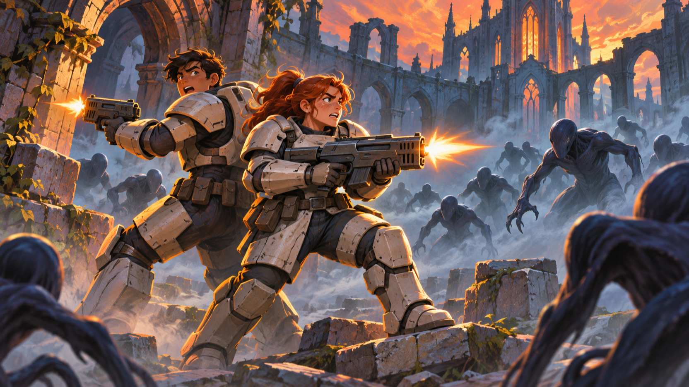

# Część 5 — Inne tryby gry

**Pierwsza bitwa, gra w pojedynkę albo razem przeciwko wrogom sterowanym przez zasady, gra w trzy i cztery osoby, kampanie**

[← Strefy walki](04_strefy_walki.md) · [Spis podręcznika](README.md) · Następna część: [Słowniczek →](06_slowniczek.md)

Misje turniejowe z [części 2](02_misje.md) to nie jedyny sposób na grę. Podręcznik Kill Team ma jeszcze trzy pakiety misji:

| Pakiet | Po polsku | Dla kogo? |
|---|---|---|
| **Preliminary Ops** | Operacje wstępne | Pierwsze gry, prosta misja 1 na 1 |
| **Joint Ops** | Operacje wspólne | Gra w pojedynkę albo we dwóch razem przeciwko wrogom sterowanym przez zasady |
| **Multiplayer Ops** | Operacje wieloosobowe | 3 albo 4 graczy |

Na końcu opisujemy też dodatki fabularne i pomysły na własną kampanię.

---

## Spis treści

1. [Open Play — graj, jak chcesz](#1-open-play--graj-jak-chcesz)
2. [Preliminary Ops — pierwsza bitwa](#2-preliminary-ops--pierwsza-bitwa)
3. [Joint Ops — razem przeciwko wrogom](#3-joint-ops--razem-przeciwko-wrogom)
4. [Multiplayer Ops — bitwa trzech lub czterech graczy](#4-multiplayer-ops--bitwa-trzech-lub-czterech-graczy)
5. [Dodatki fabularne](#5-dodatki-fabularne)
6. [Własna kampania — pomysły](#6-własna-kampania--pomysły)
7. [Jak nauczyć kogoś grać](#7-jak-nauczyć-kogoś-grać)

---

## 1. Open Play — graj, jak chcesz

**Open Play** (Gra otwarta) to po prostu gra bez sztywnych zasad misji. Możecie:

- grać bez misji — wygrywa ten, kto pokona wszystkich wrogów,
- wymyślić własną misję (np. „uratuj zakładnika”, „wysadź most”),
- zmieniać liczbę żołnierzy, rund czy rozmiar stołu,
- grać figurkami, które nie tworzą oficjalnego oddziału.

Jedyna zasada: obaj gracze muszą się zgodzić przed grą.

Jeśli gracie bez misji, podręcznik podaje proste przygotowanie:

1. Stół 30" × 22".
2. Losowo ustalcie, kto ma inicjatywę.
3. Gracz z inicjatywą wybiera jedną krawędź stołu. Przeciwnik dostaje przeciwną.
4. **Strefa rozstawienia** każdego gracza to pas do 3" od jego krawędzi.
5. Na zmianę ustawiacie po jednej trzeciej oddziału (w górę), z rozkazem Conceal.

---

## 2. Preliminary Ops — pierwsza bitwa

To najprostsza oficjalna misja dla dwóch graczy. Idealna na pierwsze gry, bo ma tylko **dwie operacje**: Kill Op i Crit Op. Nie ma Tac Op, operacji głównej ani kart inicjatywy.

### Przygotowanie

1. **Mapa:** gracz z inicjatywą rzuca kością. Na 1–3 gracie na mapie 1, na 4–6 — na mapie 2 (mapy są w podręczniku).
2. **Znaczniki celu:**
   - gracz **bez** inicjatywy stawia jeden znacznik na linii środkowej, dalej niż 2" od bocznych krawędzi,
   - potem każdy gracz stawia jeden znacznik (zaczyna gracz z inicjatywą) — każdy na innej połowie stołu, do 3" od linii środkowej, dalej niż 5" od innych znaczników i dalej niż 2" od bocznych krawędzi.
   - Na stole **Gallowdark** zamiast tego rzucacie kością (przerzucając 5 i 6) i wybieracie jedną z czterech map, na których znaczniki już są.
3. **Crit Op:** gracz z inicjatywą rzuca D3:
   - **1** — Secure (Zabezpieczenie),
   - **2** — Loot (Grabież),
   - **3** — Transmission (Transmisja).

   Opisy tych trzech operacji są w [części 2, rozdział 7](02_misje.md#7-crit-ops--operacje-krytyczne).

### Punkty

- **Kill Op** — tak samo jak w Approved Ops: 1 VP za każdy nowy poziom eliminacji i 1 VP, jeśli na końcu czwartej rundy masz wyższy poziom niż przeciwnik. Ilu wrogów trzeba pokonać na każdy poziom, sprawdzisz w [tabeli poziomów eliminacji](02_misje.md#tabela-poziomów-eliminacji).
- **Crit Op** — według wylosowanej operacji.
- Bitwa trwa **4 rundy**. Wygrywa gracz z większą liczbą VP.

> 💡 **Wskazówka:** Na pierwszą grę możecie nawet pominąć Crit Op i grać tylko Kill Op. Gdy zasady ruchu i strzelania wejdą wam w krew, dołóżcie cele misji.

---

## 3. Joint Ops — razem przeciwko wrogom

**Joint Ops** to tryb **PvE** — gracze przeciwko wrogom sterowanym przez zasady. Możesz grać:

- **sam** (solo),
- **we dwóch razem** (co-op) — wtedy obaj gracie po jednej stronie.

Wrogowie to **NPO — Non-Player Operatives** (Żołnierze bez gracza). O tym, co robią, decydują proste zasady i rzuty kośćmi.

### Zasady ogólne

- Gracze to jedna drużyna. **CP i sprzęt są wspólne** — nie dostajecie ich podwójnie.
- Gracie **jednym oddziałem**. Przy grze we dwóch możecie go podzielić — każdy dowodzi połową.
- Misję losujecie D3: **1** — Breach, **2** — Sabotage, **3** — Escape. Możecie też zagrać je po kolei jak małą kampanię.
- **Inicjatywa:** rzut porównawczy. Jeśli wygrają NPO, **zawsze biorą inicjatywę**.
- W kroku *Gambit* NPO zawsze pasują.

### Karty NPO

Wszyscy NPO mają Move 6".

| Karta | APL | Save | Rany | Broń | Specjalne |
|---|---|---|---|---|---|
| **Trooper** (Szeregowy) — *Brawler* | 2 | 5+ | 7 | Ostrza: 4 / 4+ / 3/4, *Ceaseless* | — |
| **Trooper** (Szeregowy) — *Marksman* | 2 | 5+ | 7 | Karabin: 4 / 4+ / 2/3; Broń specjalna: 4 / 4+ / 4/5, *Piercing 1*; Nóż: 3 / 4+ / 2/3 | Broń specjalna — 1 na 3 żołnierzy |
| **Tough** (Twardziel) — *Brawler* | 2 | 4+ | 10 | Ostrza: 4 / 4+ / 4/5, *Ceaseless* | — |
| **Warrior** (Wojownik) — *Marksman* | 2 | 4+ | 8 | Karabin: 4 / 4+ / 3/4; Nóż: 3 / 4+ / 2/3 | — |
| **Heavy** (Ciężki) — *Brawler* | 3 | 3+ | 14 | Ostrza: 5 / 3+ / 4/5, *Ceaseless* | Może zrobić 2 akcje Fight w aktywacji |
| **Heavy** (Ciężki) — *Marksman* | 3 | 3+ | 14 | Karabin: 4 / 3+ / 3/4; Nóż: 4 / 3+ / 3/4 | Może zrobić 2 akcje Shoot w aktywacji |

Broń zapisaliśmy jako: Atk / Hit / Dmg. Figurki NPO możesz wziąć z dowolnego oddziału, który pasuje do opisu.

### Jak zachowują się NPO

Każdy NPO ma **behaviour** (zachowanie), które mówi, co robi po kolei. Robi **pierwszą akcję z listy, którą może wykonać**.

**Brawler** (Zabijaka) — biegnie do walki wręcz.

- Rozkaz: **Engage**, jeśli może zrobić Fight albo Charge. W przeciwnym razie **Conceal**.
- Kolejność: 1. Fight → 2. Charge na najbliższego wroga → 3. Reposition w stronę najbliższego wroga (najlepiej do osłony) → 4. Dash w stronę najbliższego wroga (najlepiej do osłony).

**Marksman** (Strzelec) — szuka dobrej pozycji do strzału.

- Rozkaz: **Engage**, jeśli może strzelać. W przeciwnym razie **Conceal**.
- Kolejność: 1. Fall Back do osłony (najlepiej tam, skąd widzi cel albo znacznik) → 2. Shoot → 3. Reposition do osłony → 4. Dash do osłony.

Jeśli NPO nie może zrobić żadnej akcji z listy, po prostu kończy aktywację.

### Threat Principle (Zasada zagrożenia)

Gdy nie wiadomo, co zrobi NPO, **wybierz to, co jest najgorsze dla graczy**. Jeśli dalej nie wiesz — rzuć kością.

**Którego NPO aktywować?**

1. Tego, który może walczyć albo strzelać i jest najgroźniejszy.
2. Tego, który nie jest w osłonie przed graczami.
3. Tego, który jest bliżej gracza.

**Do kogo strzela NPO?** Po kolei wybiera cel: niezasłonięty → bez osłony → przy znaczniku celu → najbliższy → ranny → gotowy (Ready).

**Kogo atakuje wręcz?** Rannego → przy znaczniku celu → gotowego (Ready).

### Misje Joint Ops

**1. Breach** (Szturm)

- NPO o łącznej liczbie ran do **90**. Ustaw ich z rozkazem Conceal w strefie rozstawienia NPO, rozproszonych, w osłonach.
- **Wygrywasz**, gdy pokonasz wszystkich NPO. **Przegrywasz**, gdy zginą wszyscy twoi żołnierze.

**2. Sabotage** (Sabotaż)

- NPO do **90** ran, ustawieni jak w Breach.
- **Posiłki:** w każdej fazie strategii, jeśli połowa NPO została pokonana, wracają: dwóch losowych pokonanych zwykłych NPO albo jeden pokonany Heavy. Stawiasz ich z rozkazem Conceal do 3" od znacznika posiłków (w osłonie, jeśli się da).
- **Akcja Sabotage** (Sabotuj), 1 AP: na znaczniku, który kontrolujesz. Nie w pierwszej rundzie, nie w zasięgu kontroli wroga, nie na znaczniku już zsabotowanym.
- **Wygrywasz**, gdy zsabotujesz wszystkie znaczniki.

**3. Escape** (Ucieczka)

- NPO do **77** ran, ustawieni jak w Breach. Posiłki jak w Sabotage, ale w strefie rozstawienia NPO, do 6" od krawędzi i dalej niż 6" od twoich żołnierzy.
- Twój żołnierz **ucieka**, gdy całkowicie przejdzie przez krawędź stołu po stronie NPO. Zdejmujesz go ze stołu.
- Bitwa kończy się, gdy na stole nie ma już twoich żołnierzy.
- **Wygrywasz**, jeśli uciekła **więcej niż połowa** twojego oddziału.

> 💡 **Wskazówka:** Joint Ops świetnie nadają się do nauki. Dziecko i rodzic grają razem po jednej stronie, a NPO „same się ruszają” — nikt nie musi być złym przeciwnikiem.

---

## 4. Multiplayer Ops — bitwa trzech lub czterech graczy

- Potrzebujecie **dwóch stołów tej samej wielkości**, złączonych dłuższym bokiem.
- **Kolejność graczy:** każdy rzuca kością. Kto ma najwięcej, jest pierwszy (przy remisie przerzucacie). Ta kolejność zastępuje inicjatywę.
- Pierwszy gracz rzuca kością: 1–3 mapa 1, 4–6 mapa 2. Mapy są dla 3 i dla 4 graczy, także w wersji Gallowdark.

### Elimination Op (Operacja eliminacji)

- W każdej rundzie liczycie, ilu wrogów pokonał każdy gracz. Wróg z **12 lub więcej ranami** liczy się podwójnie.
- Nie liczą się żołnierze, którzy zginęli nie przez wroga (np. od własnej przegrzanej broni).
- Na końcu każdej rundy od drugiej: gracz, który pokonał najwięcej, dostaje **2 VP**, drugi — **1 VP**. Przy remisie obaj dostają punkty za wyższe miejsce.

### Crit Op

Pierwszy gracz rzuca D3: Secure, Loot albo Transmission. Działają jak zwykle, ale punktacja jest inna:

- **Secure:** 1 VP za każdy zabezpieczony znacznik, najwyżej 3 VP na rundę.
- **Loot:** 1 VP za każdą akcję Loot, najwyżej 2 VP na rundę.
- **Transmission:** 1 VP za każdy nadający znacznik, który kontrolujesz, najwyżej 3 VP na rundę.

> 💡 **Wskazówka:** W grze wieloosobowej nie atakuj zawsze najsilniejszego. Czasem lepiej poczekać, aż dwaj inni gracze się osłabią.

---

## 5. Dodatki fabularne

Games Workshop wydaje też dodatki z misjami fabularnymi. Najciekawsze dla 3. edycji:

**Kill Team: Typhon** (2025)

- **Joint Ops: Typhon** — kampania na 3 misje dla dwóch graczy grających razem. Wynik każdej misji decyduje, która będzie następna: wygrana prowadzi głębiej w gniazdo Tyranidów, przegrana zmusza do odwrotu.
- **Karty wydarzeń** — losowe zdarzenia, na przykład zasadzka małych potworków albo trująca chmura.
- **Uśpieni NPO w zwykłej grze** — potwory, które czekają na stole i budzą się, gdy ktoś je zaczepi. Atakują wtedy każdego!
- Dodatek **Tyranid Infestation** — teren z gniazdami Tyranidów.

**Nemesis Operatives** (Żołnierze-nemezis)

- Zasady tworzenia **własnych, wielkich przeciwników** (np. potwora albo pojazdu). Mają mnóstwo ran (35, 50 albo 75) i działają **dwa razy w rundzie**.
- Mogą być sterowani przez gracza albo przez zasady NPO.
- Są do nich misje Joint Ops połączone w krótką kampanię, w której wynik decyduje o następnej misji.

Szczegóły tych dodatków opiszemy w przyszłości, jeśli będziecie z nich korzystać.

---

## 6. Własna kampania — pomysły

Podręcznik 3. edycji **nie ma** oficjalnego systemu rozwoju postaci (w poprzedniej edycji był to tryb *Spec Ops*). Możecie jednak łatwo zrobić własną kampanię. Kilka pomysłów:

- **Seria misji:** zagrajcie 3–5 bitew po kolei. Kto wygra więcej, wygrywa kampanię.
- **Fabuła:** wymyślcie historię — np. „oddział musi przedostać się przez miasto do statku”. Każda bitwa to kolejny etap.
- **Wynik zmienia następną bitwę:** zwycięzca może wybrać stół albo dostać 1 dodatkowy CP na start kolejnej gry.
- **Imiona i bohaterowie:** nadajcie żołnierzom imiona i zapisujcie, kto ilu wrogów pokonał. Najlepszy żołnierz kampanii dostaje medal!
- **Ranni weterani:** żołnierz, który zginął, opuszcza następną bitwę (leczy się w szpitalu).

To są zasady domowe — ustalcie je przed kampanią i zapiszcie.

---

## 7. Jak nauczyć kogoś grać

Kilka propozycji, które ułatwiają pierwsze gry (szczególnie z młodszymi graczami):

1. **Pierwsza gra — tylko ruch i strzelanie.** Po 3 żołnierzy na stronę, bez misji, wygrywa ten, kto pokona przeciwnika.
2. **Druga gra — dodajcie walkę wręcz i rozkazy** Engage i Conceal.
3. **Trzecia gra — Preliminary Ops** z Kill Op i jedną Crit Op.
4. **Potem — Approved Ops**: Tac Ops, operacja główna, karty inicjatywy, sprzęt.
5. **Gallowdark i Tomb World** zostawcie na później, gdy podstawy będą pewne.

> 💡 Trzymajcie pod ręką [ściągawkę z części 1](01_zasady_podstawowe.md#21-ściągawka) i [słowniczek](06_slowniczek.md).

---

**Źródła:**
- Misje z podręcznika (Preliminary, Joint i Multiplayer Ops) w Wahapedii: https://wahapedia.ru/kill-team3/the-rules/the-missions/
- Nemesis Operatives w Wahapedii: https://wahapedia.ru/kill-team3/the-rules/nemesis-operatives/
- Opis dodatku Kill Team: Typhon (Frontline Gaming): https://frontlinegaming.org/2025/06/12/kill-team-typhon-a-narrative-and-tactical-infestation-unleashed/
- Recenzja zasad podstawowych 3. edycji (Goonhammer): https://goonhammer.com/kill-team-2024-review-the-core-rules

[← Strefy walki](04_strefy_walki.md) · [Spis podręcznika](README.md) · Następna część: [Słowniczek →](06_slowniczek.md)
