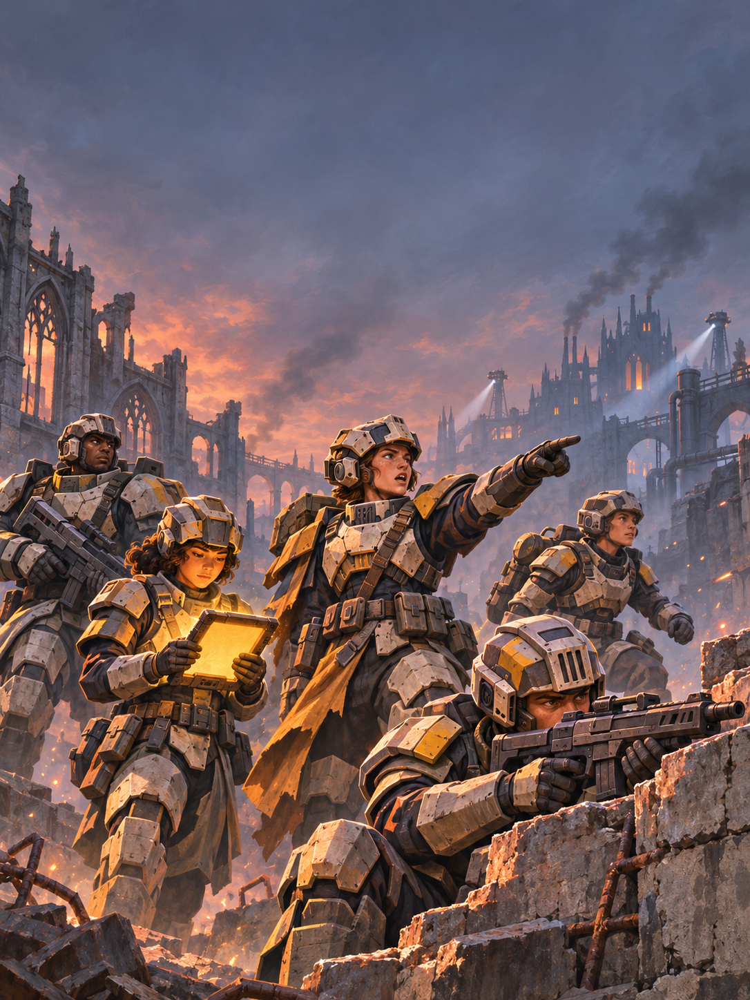

# Kill Team — Podręcznik po polsku

**Zasady gry Warhammer 40,000: Kill Team (3. edycja), wytłumaczone prostym językiem**

Ten podręcznik tłumaczy zasady Kill Team tak, żeby zrozumiał je jedenastolatek — ale przyda się każdemu, kto zaczyna grać. Zasady są aktualne na **listopad 2026**: według podręcznika 3. edycji (2024), talii misji Approved Ops 2025 i wszystkich oficjalnych poprawek do października 2026.

---

## Części podręcznika

| Część | Plik | O czym? |
|---|---|---|
| 1 | [Zasady podstawowe](01_zasady_podstawowe.md) | Ruch, strzelanie, walka wręcz, osłona, rozkazy, cechy broni, teren |
| 2 | [Misje](02_misje.md) | Przygotowanie bitwy, punkty zwycięstwa, Crit Ops, Tac Ops, Kill Op |
| 3 | [Sprzęt](03_sprzet.md) | Granaty, drabiny, barykady, miny i inny sprzęt uniwersalny |
| 4 | [Strefy walki](04_strefy_walki.md) | Stoły Volkus, Bheta-Decima, Gallowdark, Tomb World, Octarius; walka w korytarzach |
| 5 | [Inne tryby gry](05_inne_tryby_gry.md) | Pierwsza bitwa, gra solo i we dwóch przeciwko NPO, gra w 3–4 osoby, kampanie |
| 6 | [Słowniczek](06_slowniczek.md) | Wszystkie angielskie słowa z gry, alfabetycznie |
| 7 | [Oddziały](07_oddzialy/README.md) | Zasady poszczególnych kill teamów: Kommandos, Deathwatch, Legionaries, Phobos Strike Team, Wrecka Krew, Corsair Voidscarred, Fellgor Ravagers, Canoptek Circle, Spectre Squad, Vespid Stingwings, Farstalker Kinband, Pathfinders, Battleclade, Goremongers, Sanctifiers, Celestian Insidiants, Murderwing — wszystkie 17 oddziałów |
| — | [Prompty do obrazków](prompty_obrazki.md) | Opisy do wygenerowania ilustracji i schematów |

**Od czego zacząć?** Przeczytaj część 1, zagraj pierwszą bitwę z [części 5](05_inne_tryby_gry.md#2-preliminary-ops--pierwsza-bitwa), a potem przejdź do misji z części 2.

Zasady konkretnych oddziałów są w [części 7](07_oddzialy/README.md). Pamiętaj, że **zasada z karty oddziału zawsze wygrywa** z zasadami ogólnymi.

---

## Jak czytać ten podręcznik

W grze wszystkie nazwy są po angielsku. Zostawiamy angielską nazwę, a obok w nawiasie dajemy polskie tłumaczenie:

> **Silent** (Cicha): możesz strzelać z tej broni, nawet gdy twój żołnierz się ukrywa.

W tekście znajdziesz też ramki:

> 💡 **Wskazówka** — podpowiedź, jak grać sprytniej.

> ⚠️ **Uwaga** — miejsce, gdzie gracze często się mylą.

Skróty, które pojawiają się wszędzie:

- **AP** — Action Points (punkty akcji),
- **APL** — Action Point Limit (limit punktów akcji),
- **CP** — Command Points (punkty dowodzenia),
- **VP** — Victory Points (punkty zwycięstwa),
- **"** — cal (2,54 cm).

---

## Obrazki

Folder `obrazki/` ma dwa rodzaje obrazków:

- **Schematy** (`obrazki/01_…png` do `obrazki/12_…png`) — proste rysunki zasad. Już są w folderze. Można je zastąpić ładniejszymi wersjami według [promptów](prompty_obrazki.md) — pod tymi samymi nazwami.
- **Ilustracje** (`obrazki/ilustracje/il_…png`) — klimatyczne obrazki na początek rozdziałów, wygenerowane według [promptów](prompty_obrazki.md). Nową wersję zapisz pod tą samą nazwą.

---

## Gdzie szukać oficjalnych zasad

- **Aplikacja Kill Team** (iOS, Android) — zawsze najnowsze zasady. Według oficjalnych zasad turniejowych aktualizacje w aplikacji są ważniejsze od drukowanych.
- **Oficjalne pliki do pobrania:** https://www.warhammer-community.com/en-gb/downloads/kill-team/
- **Darmowe Lite Rules (PDF):** https://assets.warhammer-community.com/eng_jul25_kt_lite_rules-jmjv4hdamy-qlsqxdf83p.pdf
- **Wahapedia** (nieoficjalna, ale wygodna): https://wahapedia.ru/kill-team3/

---

## Historia zmian podręcznika

- **Listopad 2026** — wersja 4: pozostałe 14 oddziałów: Phobos Strike Team, Wrecka Krew, Corsair Voidscarred, Fellgor Ravagers, Canoptek Circle, Spectre Squad, Vespid Stingwings, Farstalker Kinband, Pathfinders, Battleclade, Goremongers, Sanctifiers, Celestian Insidiants i Murderwing.
- **Listopad 2026** — wersja 3: dodana część 7 — oddziały Kommandos, Deathwatch i Legionaries.
- **Listopad 2026** — wersja 2: podręcznik podzielony na części; dodane misje (Approved Ops 2025, Preliminary Ops, Joint Ops, Multiplayer Ops), sprzęt uniwersalny, strefy walki i słowniczek.
- **Listopad 2026** — wersja 1: zasady podstawowe.

---

*Warhammer 40,000, Kill Team i wszystkie powiązane nazwy są znakami towarowymi Games Workshop. To nieoficjalny, darmowy poradnik dla graczy. Nie zastępuje oficjalnych zasad — do gry potrzebujesz podręcznika lub aplikacji Kill Team.*
